# Kiflet architecture

This is the target architecture for Kiflet: what the platform needs, how
it is split into parts, and how those parts scale. `docs/migration.md` is the
plan for getting there from today's single Go application.

This repository, **Kiflet/backend**, holds the backend and the
infrastructure, so this document covers the whole platform. The two
clients have their own, in more detail:
[Kiflet/web `docs/architecture.md`](https://github.com/Kiflet/web/blob/main/docs/architecture.md)
and [Kiflet/mobile `docs/architecture.md`](https://github.com/Kiflet/mobile/blob/main/docs/architecture.md).

The decisions it rests on, agreed on 2026-11-18 and revised on 2026-11-19
after the audit in `docs/audit-2026-11-19.md` (the repositories were
created in the Kiflet organization on 2026-11-19):

| Decision | Choice |
|---|---|
| Codebases | Three, in the [Kiflet](https://github.com/Kiflet) organization: **Kiflet/backend** (this one: backend and infrastructure), **Kiflet/web** (Next.js), **Kiflet/mobile** (React Native with Expo) |
| Backend shape | Go, a **modular monolith** deployed as several processes (API, workers, scheduler) fed by RabbitMQ; modules can become services later |
| Driver app | React Native with Expo, its own **SQLite** database, works offline, GPS with the screen off |
| Web | Next.js (App Router, TypeScript): the dashboard, the operator's pages and the public pages |
| API | **One versioned API**, `/api/v1`, for every client: Kiflet/web with its session, Kiflet/mobile with its driver token, companies' systems with API keys; one OpenAPI specification, `api/openapi/v1.yaml` (decided 2026-11-19). The backend serves no pages |
| Driver sync | The phone holds the driver's work; each sync sends what the phone recorded and brings back only what changed, from a **change feed per driver** (decided 2026-11-19) |
| Broker | **RabbitMQ**: GPS positions, notifications, webhooks, domain events, live updates, scheduled jobs |
| Cache | **Redis**: sessions, rate limits, latest positions, hot tenant data |
| Files | **[Garage](https://garagehq.deuxfleurs.fr/)** (`dxflrs/garage`), S3-compatible, three nodes on our VMs: signatures, photos, documents, exports. Database backups still go to a bucket with another provider (decided 2026-11-19) |
| Scale | Up to **20,000 drivers** in the next 2–3 years, hundreds of companies |
| Hosting | **VMs with Docker Compose**, each part scaled by replicas |

Contents:

1. [What the platform has to do](#1-what-the-platform-has-to-do)
2. [System context](#2-system-context)
3. [The deployable parts](#3-the-deployable-parts)
4. [The backend's modules](#4-the-backends-modules)
5. [Data](#5-data)
6. [RabbitMQ](#6-rabbitmq)
7. [Redis](#7-redis)
8. [The main flows](#8-the-main-flows)
9. [The driver app](#9-the-driver-app)
10. [The web app](#10-the-web-app)
11. [The API and its contracts](#11-the-api-and-its-contracts)
12. [Security](#12-security)
13. [Deployment](#13-deployment)
14. [Observability](#14-observability)
15. [Capacity at 20,000 drivers](#15-capacity-at-20000-drivers)
16. [What is deliberately not in it](#16-what-is-deliberately-not-in-it)

---

## 1. What the platform has to do

Kiflet tracks shipments for Ethiopian trucking companies and records proof
of delivery. What that asks of the system:

| Need | What it means for the architecture |
|---|---|
| Drivers lose signal for hours | The driver app keeps everything on the phone (SQLite) and sends it later. Every write from the phone is idempotent, so sending twice is harmless, and each sync brings back only what changed. |
| Many phones reconnect at once | When a convoy comes back into coverage, or after a network outage, thousands of phones send hours of positions together. Ingest must absorb bursts without slowing the dashboard: positions go through RabbitMQ to workers. |
| Some drivers have feature phones | SMS in (`ET <ref> <code>`) and out, through Ethio telecom. SMS is a first-class input channel, not an add-on. |
| Dispatchers watch live | Positions and status changes reach the dashboard within seconds, across every API instance. |
| Customers have no account | Public tracking pages, confirmation links and SMS. Fast, small and light on data. |
| Proof of delivery is evidence | Signatures and photos are kept in object storage, with the place and time recorded, and the history can't be altered (append-only events and audit log). |
| Companies are separate | Every row carries its tenant, and every query is scoped by it. One company can never see another's data. |
| Companies pay | Plans, invoices, telebirr and CBE Birr payments, plan limits. |
| Companies integrate | A public REST API with keys, and signed webhooks with retries. |
| Things must keep working when parts fail | SMS, email, webhooks and alerts are queued and retried. Redis or RabbitMQ going down degrades the system but loses nothing. |

---

## 2. System context

Who and what Kiflet talks to.

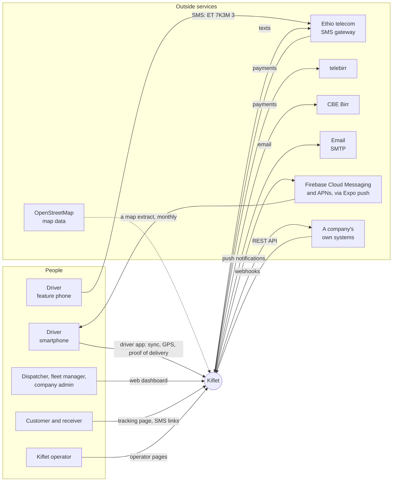

---

## 3. The deployable parts

Each box is a container image. Everything except the clients and the
outside services runs on the company's VMs with Docker Compose (section 13).

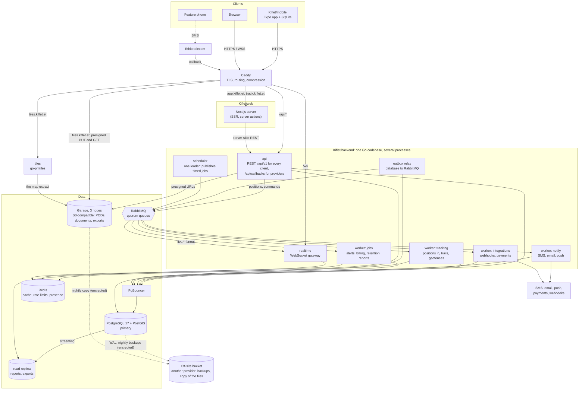

| Part | Repository | Language | Scales by | State |
|---|---|---|---|---|
| Caddy | Kiflet/backend (`deployments/`) | config | 1–2 instances behind DNS | none |
| Next.js server | Kiflet/web | TypeScript | replicas | none |
| `api` | Kiflet/backend, `cmd/server`, role `api` | Go | replicas | none (Postgres, Redis) |
| `realtime` | Kiflet/backend, `cmd/server`, role `realtime` | Go | replicas | connections only |
| `worker` | Kiflet/backend, `cmd/server`, role `worker` with its queues | Go | replicas per queue group | none |
| `scheduler` | Kiflet/backend, `cmd/server`, role `scheduler` | Go | 2 instances, one leads (advisory lock) | none |
| `relay` | Kiflet/backend, `cmd/server`, role `relay` | Go | 2 instances, one leads | none |
| `tiles` | image `protomaps/go-pmtiles`, pinned | Go | 1–2 replicas | none (the extract is in Garage) |
| PostgreSQL + PostGIS | image | | primary + replica; vertical first | source of truth |
| PgBouncer | image | | 1 per database VM | none |
| RabbitMQ | image | | 3-node cluster | durable queues |
| Redis | image | | 1 primary + replica with Sentinel | can be lost |
| Garage | image `dxflrs/garage`, pinned (v2.5.0 on 2026-11-19) | | 3 nodes, replication factor 3; add nodes and disks | files |
| Off-site bucket | another provider (still to choose) | | | encrypted backups, a copy of the files |
| Driver app | Kiflet/mobile | TypeScript | phones | SQLite on the phone |

All the Go processes are one program, `cmd/server`, started with
different roles (`serve --roles=…`). Today's roles are `web`, `worker`,
`scheduler` and `relay`; `web` splits into `api` and `realtime` once the
Go pages are gone (`docs/migration.md`, phase 5). They share modules, but
each process only starts what it needs. This keeps the business rules in one place while letting the parts
under load (positions, notifications) scale on their own.

---

## 4. The backend's modules

The backend is split into modules by business area. A module owns its
tables, its rules and its HTTP handlers. Other modules reach it only
through its Go interface (synchronous) or its events (asynchronous), never
by querying its tables.

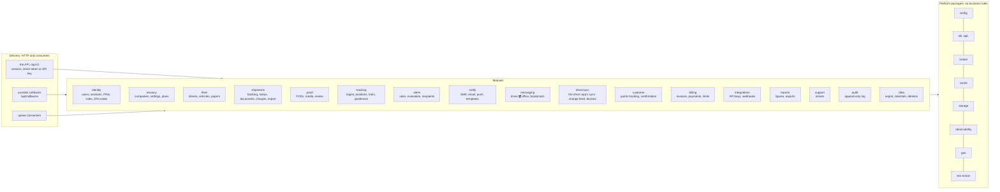

### How modules depend on each other

The arrows point the way calls go. There are no cycles: a module lower down
never calls one higher up; it publishes an event instead.

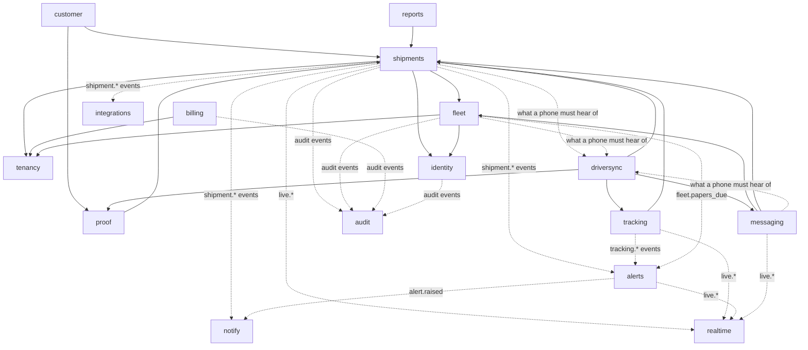

### What each module owns

| Module | Owns (tables) | Publishes | Consumes |
|---|---|---|---|
| identity | `users`, `sessions`, `verification_codes`, `email_tokens`, `pending_signups` | `user.created`, `user.disabled` | |
| tenancy | `tenants`, `saved_filters` | `tenant.created`, `tenant.suspended`, `tenant.deleted` | `billing.standing_changed` |
| fleet | `vehicles`, fleet papers, driver profile fields | `fleet.papers_due` | `tracking.driver_seen` |
| shipments | `shipments`, `shipment_events` (append-only), `shipment_documents`, `shipment_charges` | `shipment.booked`, `.assigned`, `.status_changed`, `.delivered`, `.cancelled` | `proof.recorded`, `sms.status_reported` |
| proof | `proof_of_deliveries`, `pod_media` (each file, with when and where it was taken), `uploads` (presigned uploads not yet used) | `proof.recorded`, `proof.reviewed` | |
| tracking | `tracking_events` (partitioned; `mocked` marks a position from a mock location), `driver_positions` | `tracking.position_stored`, `.stop_started`, `.off_route`, `.arrived_near`, `.driver_seen` | `tracking.positions` (commands) |
| alerts | `alerts`, `alert_rules` | `alert.raised`, `alert.resolved` | shipment, tracking and fleet events; `jobs.alerts.*` |
| notify | `sms_messages`, `sms_opt_outs`, `emails`, `push_tokens` | `sms.status_reported`, `sms.inbound` | `notify.sms`, `notify.email`, `notify.push` |
| messaging | `broadcasts`, `broadcast_recipients`; messages between a driver and the office are shipment events (`shipment_events`), written through shipments | `message.sent` | |
| driversync | `driver_feed`, `driver_feed_heads`, `driver_devices`, `driver_diagnostics`, `sync_metadata` | | shipment events and `message.sent`, within their transactions (section 11, "The driver sync") |
| customer | confirmation links | `customer.confirmed` | |
| billing | `invoices`, `invoice_counters`, `payments`, `billing_notices` | `billing.invoice_issued`, `.paid`, `.standing_changed` | `jobs.billing.*` |
| integrations | `api_keys`, `webhook_endpoints`, `webhook_deliveries` | | shipment events (delivered as webhooks) |
| reports | read models (materialised views) | | `jobs.reports.refresh` |
| support | `support_tickets`, `support_messages` | `support.message` | |
| audit | `audit_logs` (append-only) | | `audit.*` |
| data | | | `jobs.retention`, `data.export_requested` |

### Inside a module

Every module has the same layout, so anyone can find their way around any
of them:

```
internal/modules/shipments/
  shipments.go       the module's Go interface: what other modules may call
  domain/            types and rules, no I/O (statuses, transitions, validation)
  app/               use cases: Book, Assign, ChangeStatus... (transactions, events)
  store/             sqlc queries for its own tables (queries/*.sql → generated)
  http/              its operations of the API (/api/v1), from the generated interface
  events/            event types it publishes, with versions; consumers it runs
  shipments_test.go  module tests against a real Postgres
```

Rules that hold in every module:

- **Tenant first.** Every query takes the tenant ID, and every table has
  `tenant_id`. A reference from one company-owned table to another
  carries it too (`(tenant_id, x_id) REFERENCES x (tenant_id, id)`), so the
  database refuses a row that points into another company. A test runs
  each query with another tenant's IDs and expects nothing back. A query
  that is global on purpose says why (`-- tenant: none, <reason>`), and CI
  fails on one that doesn't.
- **One transaction, one outbox write.** A use case that changes data and
  must tell others writes its event to `outbox` in the same transaction
  (section 6). No event is lost and none is sent for a change that was
  rolled back.
- **Handlers stay thin.** They parse, call one use case and render JSON.
  The rules are in `app/` and `domain/`.
- **Rules stay in one place.** The status transitions are in
  `shipments/domain`; the driver app reads them from the API
  (`/api/v1/driver/config`), and the web from each record's `actions`,
  never from a copy of their own.

---

## 5. Data

### PostgreSQL is the source of truth

One PostgreSQL 17 cluster with PostGIS. Each module's tables move into
their own **schema** (`shipments.shipments`, `tracking.tracking_events`…)
so ownership shows in the database too, and a module could later move to
its own database without untangling joins.

- **Connections:** through PgBouncer in transaction mode. At 20,000 drivers
  the API and workers together need about 200 server connections, which a
  single primary handles.
- **Read replica:** reports, CSV and PDF exports, and the company data
  export read from a streaming replica, so a large report never slows
  dispatch.
- **Append-only tables:** `shipment_events` and `audit_logs` keep their
  triggers that reject UPDATE, DELETE and TRUNCATE. Purges run in
  `purgeTx`, as today.
- **Migrations:** goose, run by `server migrate` as a one-off container before
  a deploy, not at API start (several replicas must not race). Each
  migration is rerunnable and backwards-compatible with the version
  running, so deploys need no downtime ("expand, then contract").
- **References carry the tenant** (section 4), and row-level security is
  a second wall (section 12).
- **Versions:** every record people edit (shipments, users, vehicles,
  companies, webhook endpoints, alert rules) has a `version`, raised by
  each update. The API sends it as the `ETag` and checks `If-Match`
  (section 11).
- **Money** is whole santim (`bigint`) everywhere: charges, cargo values,
  invoices and payments.
- **Idempotency keys** are kept in `idempotency_keys` for 24 hours, with
  the request's hash and the first response (section 11): in Postgres, not
  Redis, so a replay is recognised even after Redis is lost.
- **The driver feed** (`driver_feed`) gains an entry for every change a
  driver's phone must hear of, and keeps 30 days (section 11, "The driver
  sync").

### GPS positions

`tracking_events` is the only table that grows fast: about 6 million rows
on a busy day at 20,000 drivers (section 15).

- **Partitioned by day** (native declarative partitions). The scheduler
  creates tomorrow's partition ahead of time. Retention drops whole
  partitions older than 90 days instead of deleting rows, which is instant
  and leaves no bloat.
- **Indexes per partition:** `(shipment_id, recorded_at)`,
  `(tenant_id, driver_id, recorded_at DESC)`, and BRIN on `recorded_at`.
  The GiST index on `coordinates` moves to `driver_positions` and the
  geofence tables, which are small.
- **Written in batches:** the tracking worker writes with `COPY` or
  multi-row `INSERT … ON CONFLICT (device_id, client_id) DO NOTHING`, a few
  hundred positions per statement.
- **Simplified after delivery:** 30 days after delivery a job keeps one
  position every 5 minutes plus every stop and turn (Douglas–Peucker), so
  the trail still draws but takes a fifth of the space.

### Object storage: Garage

Signatures, photos, shipment documents and data exports live in
[Garage](https://garagehq.deuxfleurs.fr/), an S3-compatible store we run
on our own VMs (image `dxflrs/garage`, pinned to a release; v2.5.0 on
2026-11-19). The app talks to it through `pkg/storage`'s S3 adapter
(aws-sdk-go-v2), so no module knows which store it is. The API hands out
**presigned URLs**: phones upload photos straight to storage and the API
never carries the bytes. Every object key starts with the tenant ID. Each
file of a delivery is a row of `pod_media`: its key, size and MD5, and
when and where it was taken.

How it is set up:

- **Three nodes, replication factor 3,** one per VM, each in its own zone
  in Garage's layout, so any one VM can be lost with no file lost and no
  upload refused. Garage's own advice is three nodes at least; a factor of
  1 is for tests only. Metadata on SSD (the `lmdb` engine with Garage's
  metadata snapshots turned on, since LMDB can be damaged by an unclean
  shutdown); data on the larger, slower disk, XFS rather than ext4.
- **Buckets:** `kiflet` (the app's files) and `kiflet-exports` (data
  exports and reports, with a lifecycle rule that expires them after 7
  days). Garage supports lifecycle `Expiration` and
  `AbortIncompleteMultipartUpload`, nothing else.
- **Keys:** Garage has no bucket policies or ACLs, only "this key may
  read, write or own this bucket". So each process gets its own key with
  only what it needs: the app reads and writes `kiflet` and
  `kiflet-exports`. Keys are imported through the admin API by
  `kiflet setup-storage` (`pkg/storage/garage`), run as an init container
  at every deploy, not written in the config file.
- **Addressing:** path-style (`files.kiflet.et/kiflet/<key>`), so one
  certificate and no wildcard DNS (`S3_FORCE_PATH_STYLE`). `s3_region` in
  `deployments/garage/garage.toml` and `S3_REGION` must be the same string,
  or every signature is refused.
- **Reached from outside** only through Caddy at `files.kiflet.et`, which
  forwards the S3 port (3900) and nothing else. Presigned URLs are signed
  for that host (`S3_PUBLIC_ENDPOINT`), not the private one the app uses.
  The admin (3903) and RPC (3901) ports stay on the private network. CORS
  on the buckets lets pages on `app.kiflet.et` read the answers to their
  uploads; Garage answers every preflight with `*`, so the URL's signature,
  not CORS, is what keeps a file private.
- **Checksums:** recent AWS SDKs add CRC32 checksums to every request by
  default, and Garage's support for them varies by version. `pkg/storage`
  already sends and checks them only where S3 requires them, and that
  setting stays.

What Garage does not do, and what covers it:

- **No versioning and no object lock.** A file deleted or overwritten (by a
  bug, a stolen key or a mistake) is gone from Garage, whatever the
  replication. Proof of delivery is evidence, so the nightly
  `scripts/backup.sh` archives the bucket (rclone), encrypts it with age,
  and copies it to the **off-site bucket** with another provider, which
  keeps versions; `scripts/restore.sh` puts it back. The app
  never deletes a POD file except through retention and company deletion
  (`purgeTx`), and those are logged.
- **Not a backup of itself.** Replication protects against a disk or a VM,
  not against the site. Database backups and archived WAL therefore go to
  the off-site bucket, as `docs/deploy.md` describes today, never only to
  Garage on the same VMs. (Garage can run nodes in several places; a second
  site would be its own decision.)
- **No server-side encryption at rest** (SSE-S3, SSE-KMS). The storage
  VMs' disks are encrypted instead (LUKS), and the off-site copy is
  encrypted by us before it leaves.
- **Licence:** AGPLv3. We run it unmodified as a separate service, which
  asks nothing of our code; a change to Garage itself that we ran for users
  would have to be published.

### Redis holds nothing that can't be rebuilt

Section 7. If Redis is emptied, everything still works, only slower until
the cache fills again.

---

## 6. RabbitMQ

### Why a broker, and what for

Postgres can store 350 positions a second. The broker is there for what
happens around the positions:

- **Bursts:** a few thousand phones reconnecting at once send hours of
  positions in a minute. The API accepts them into a durable queue and
  answers at once. Workers drain the queue at a steady rate.
- **Isolation:** a slow SMS gateway or a company's broken webhook endpoint
  backs up its own queue. The API and the dashboard don't notice.
- **Fan-out:** one "shipment delivered" event reaches alerts, notify,
  webhooks, live updates and audit, each with its own retries.
- **Scaling by work type:** more tracking workers when positions pile up,
  without adding API replicas.

### Topology

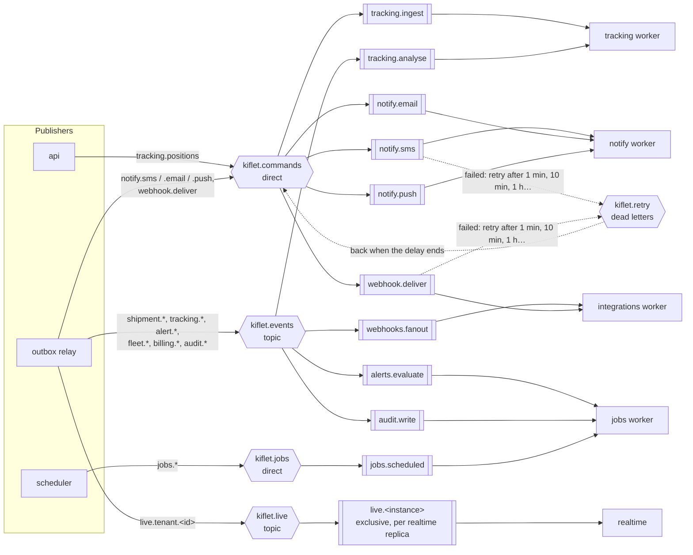

| Queue | Kind | Consumers | Prefetch | On failure |
|---|---|---|---|---|
| `tracking.ingest` | quorum | tracking worker, 2–6 | 500 (batches) | 5 retries, then `tracking.ingest.dead` with an alert to the operator |
| `tracking.analyse` | quorum | tracking worker | 100 | retry; the next position re-evaluates anyway |
| `alerts.evaluate` | quorum | jobs worker | 50 | retry ×5, dead letter |
| `notify.sms` | quorum | notify worker | 20 (gateway rate) | delayed retries over 24 h, then marked failed in `sms_messages` |
| `notify.email` | quorum | notify worker | 20 | delayed retries over 24 h |
| `notify.push` | quorum | notify worker | 100 | 3 retries; an invalid token is deleted |
| `webhook.deliver` | quorum, one per delivery | integrations worker | 20 | Standard Webhooks schedule over 24 h, as today |
| `webhooks.fanout` | quorum | integrations worker | 50 | retry; creates `webhook_deliveries` rows |
| `audit.write` | quorum | jobs worker | 200 | retry; never dropped |
| `jobs.scheduled` | quorum | jobs worker | 1 | the next tick runs it again |
| `live.<instance>` | classic, exclusive, auto-delete, TTL 10 s | its realtime replica | 500 | dropped: live updates are best-effort, pages refetch |

### Rules every message follows

- **Envelope:** each message carries `id` (UUID), `type` (for example
  `shipment.status_changed`), `version`, `tenant_id`, `occurred_at`,
  `trace_id` and `payload`. Consumers ignore versions they don't know and
  keep accepting the previous version for one release after a change.
- **At least once:** publishers use publisher confirms; consumers ack after
  their transaction commits. So any message may arrive twice, and every
  consumer is idempotent: it records the message ID (`processed_messages`,
  kept 7 days) or relies on a unique key (`client_id` for positions,
  `delivery_id` for webhooks).
- **Order:** only per shipment where it matters. Status events carry the
  shipment's event sequence number; a consumer that sees an older one than
  it has applied skips it.
- **The outbox:** a use case writes its events to an `outbox` table in the
  same transaction as the change. The relay reads new rows (`SELECT … FOR
  UPDATE SKIP LOCKED`, woken by `LISTEN`), publishes with confirms, then
  marks them sent. If RabbitMQ is down, events wait in Postgres and nothing
  is lost.
- **The exception is positions:** the API publishes them straight to
  `tracking.ingest` with a confirm before it answers the phone, because
  writing them to Postgres first would defeat the point of the queue. The
  phone keeps a position in its SQLite until the API confirms it, so a
  failed publish just means the phone sends it again.

---

## 7. Redis

Redis speeds things up and coordinates replicas. It is never the only copy
of anything.

| Use | Keys | TTL | If Redis is gone |
|---|---|---|---|
| Session lookup | `sess:<token-hash>` → user, tenant, role, expiry | 5 min, refreshed | Read `sessions` from Postgres |
| Driver tokens | `dtok:<token-hash>` | 5 min | Postgres |
| API keys | `key:<hash>` → tenant, scopes | 5 min | Postgres |
| Rate limits | `rl:<route>:<ip or user>` sliding window (Lua) | window | Fall back to per-instance memory limits, with lower limits |
| Latest driver positions | `pos:<tenant>` hash of driver → lat, lng, at, speed, battery | 7 days | Read `driver_positions` |
| Presence | `online:<tenant>` sorted set, driver → last seen | 15 min | Use `sync_metadata.last_sync_at` |
| Tenant data | `tenant:<id>` settings, plan, limits, standing | 10 min, deleted on change | Postgres |
| Sync idempotency | `sync:<device>:<request-id>` → stored response | 10 min | Each item is idempotent by `client_id` anyway |
| Fleet map payload | `fleetmap:<tenant>` | 15 s | Built from Postgres |
| One-time codes, attempt counts | `otp:<phone>` | 10 min | Postgres (`verification_codes`) |
| Leader lock (backup) | `lock:scheduler` | 30 s | The Postgres advisory lock is the real one |

Cache entries are removed when their source changes: the module that
changes a tenant's settings deletes `tenant:<id>` after the commit (and
publishes `tenant.changed`, which other replicas use to clear their own
memory caches).

Redis runs with AOF persistence so a restart doesn't empty it, and with a
replica and Sentinel so a VM failure doesn't take it down. With one VM's
worth of data (a few GB at 20,000 drivers), one primary is enough.

---

## 8. The main flows

### A driver syncs (positions, statuses, a delivery)

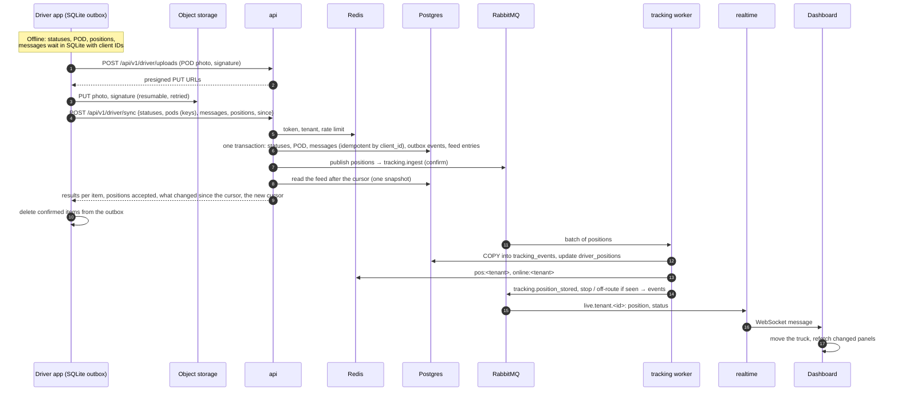

The sync stays one request with many items, as today: one round trip on a
weak connection is worth more than tidy endpoints. Each item succeeds or
fails on its own, and the response says which. What comes back is only
what changed since the phone's cursor (section 11, "The driver sync").

### A dispatcher books a load

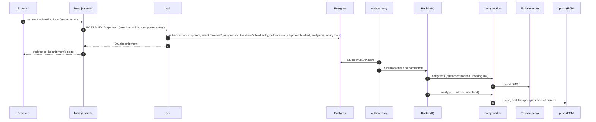

### A feature-phone driver reports by SMS

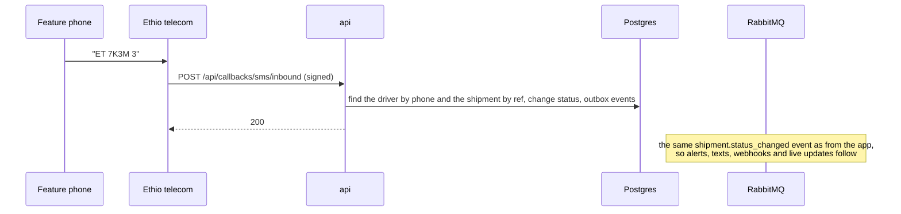

### Live updates reach every open dashboard

Each realtime replica binds its own exclusive queue to `kiflet.live` with
the routing keys of the tenants whose dashboards are connected to it. A
message names what changed (`shipment`, `alerts`, `position`) and the IDs;
the page refetches the parts it shows. Live messages carry no data a user
of that tenant couldn't read anyway, and are dropped rather than queued for
long, because the page catches up on its next fetch.

---

## 9. The driver app

In detail, with its database tables, the sync protocol and the plan:
[Kiflet/mobile `docs/architecture.md`](https://github.com/Kiflet/mobile/blob/main/docs/architecture.md).

React Native with Expo, TypeScript, Android first (most drivers), iOS from
the same code.

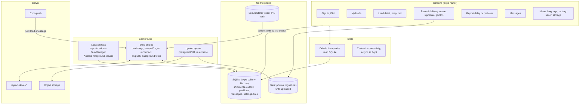

### Offline first

- **The phone holds the driver's work:** the active loads with all a
  screen shows, those finished in the last 7 days, the messages, the
  settings, the server's config with the words for every code, and
  everything not yet sent. The sync keeps it up to date with what changed
  (section 11, "The driver sync").
- **The screen reads only SQLite.** Nothing waits on the network. A
  driver's action (depart, arrive, deliver, report) writes the new state
  and an outbox row in one SQLite transaction and shows at once.
- **The outbox** holds every change with a `client_id` (UUID), its type,
  its payload and how many times it was tried. The sync engine sends
  everything waiting, oldest first, and deletes an item only when the
  server confirms it. Duplicates are harmless because the server is
  idempotent by `client_id`.
- **Positions** go into their own table and are sent oldest first, 2,000 a
  request (500 on a weak signal), compressed (gzip). A phone that has been
  out of signal for a day sends them over several syncs.
- **Conflicts:** the server is the judge. When the office changed a load
  while the phone was offline, the sync result says so and the app takes
  the server's version, telling the driver what changed (as the PWA does
  now, `docs/E2E_TEST_GUIDE.md` section 5).
- **Space:** delivered loads are deleted after 7 days; photos after they're
  uploaded and confirmed. The menu shows what the app holds.
- **Schema changes:** Drizzle migrations run when the app starts. A sync
  from an app older than the server supports gets `426 Upgrade Required`,
  and the app says to update.

### GPS that keeps going

- `expo-location` background updates through `TaskManager`, as an Android
  **foreground service** with a permanent notification ("Kiflet is
  recording your trip"), so Android doesn't kill it with the screen off.
- One position a minute while moving, every 5 minutes when slow, none
  after 10 minutes parked (as today, `static/driver/gps.js`). Battery
  saver: every 15 minutes, coarse accuracy.
- The location task only writes to SQLite; the sync engine sends. A
  position is kept even if the app is killed before the next sync.
- Tracking runs only while the driver has an active load and location
  sharing is on, and stops when the last load is delivered.

### Updates

- **Expo Updates (EAS Update)** for JavaScript changes: phones get them at
  the next start, without the Play Store. Native changes (new permissions,
  SDK upgrades) need a store release.
- Distributed through Google Play, with a signed APK on the website for
  phones without Play.

---

## 10. The web app

In detail, with its routes, the design tokens and the plan:
[Kiflet/web `docs/architecture.md`](https://github.com/Kiflet/web/blob/main/docs/architecture.md).

Next.js with the App Router, TypeScript, React Server Components.

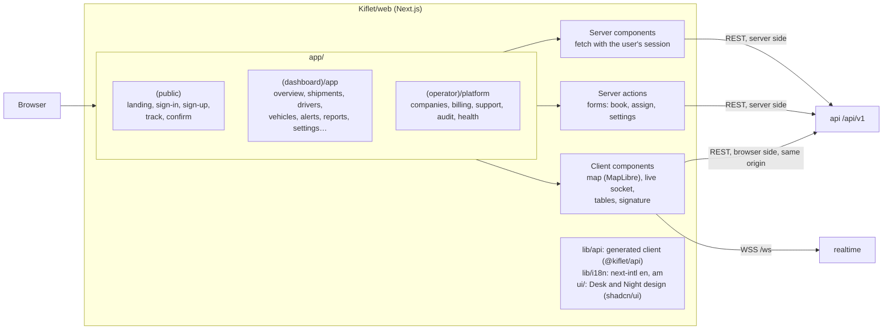

- **One origin.** Caddy serves Next.js at `app.kiflet.et` and sends
  `/api/*` and `/ws` on the same host to the Go services. The session
  cookie is `HttpOnly`, `Secure`, `SameSite=Lax`, set by the Go API, and
  works for both, so there is no token in the browser's JavaScript and no
  CORS. Every request the cookie authenticates passes the backend's
  cross-origin check (section 12).
- **Rendering:** pages render on the server with the user's session
  (server components call the API with the cookie forwarded). Interactive
  parts (map, live updates, filters, the signature pad) are client
  components.
- **The design:** the Desk (light) and Night (dark) tokens from today's
  `static/app.css` become Tailwind theme tokens and shadcn/ui components;
  Desk is already shadcn/ui's new-york style. Fonts (Geist) and lucide
  icons come over as they are.
- **Text:** next-intl with `en` and `am` message files. Public pages and
  everything a customer reads are in both languages from the first
  release, as now; the dashboard's Amharic waits for review (W1).
- **Maps:** MapLibre GL with the platform's own vector tiles
  (`tiles.kiflet.et`, section 13), in the Desk and Night styles; the
  trails and gaps drawn as on today's maps.
- **Public pages are small:** tracking and confirmation pages are rendered
  on the server with almost no JavaScript, because customers open them on
  cheap phones over mobile data.
- **Security headers:** a strict CSP with nonces (Next.js middleware), as
  strict as today's `script-src 'self'`.

---

## 11. The API and its contracts

One API, `/api/v1`, for every client (decided 2026-11-19). Kiflet/web,
Kiflet/mobile and companies' own systems call the same operations; what
differs is how the caller shows who it is, and which operations it may
call. An operation is built once, with one shape, one set of rules and one
set of tests.

| Surface | Path | Who | Auth | Contract |
|---|---|---|---|---|
| The API | `/api/v1/*` | Kiflet/web (its server and the browser), companies' systems | the session cookie, or an API key (`Authorization: Bearer`) | `api/openapi/v1.yaml` |
| The driver's operations | `/api/v1/driver/*` | Kiflet/mobile, and the PWA until it goes | a driver token from the PIN sign-in, one per device | the same file |
| Callbacks | `/api/callbacks/*` | Ethio telecom, telebirr, CBE Birr | each provider's signature | the adapters (`pkg/sms`, `pkg/payments`) and the sandbox |
| Live | `/ws` | Kiflet/web | the session cookie | `api/asyncapi/live.yaml` |
| Webhooks | out | companies' systems | Standard Webhooks signature | `api/asyncapi/webhooks.yaml` |

Everything under `/api/v1` is in the specification. The providers'
callbacks, once under `/api/v1/sms` and `/api/v1/payments`, moved to
`/api/callbacks` before any provider was given an address.

### Who may call what

Each operation is tagged with its audience, and the tag decides who may
call it and how it may change:

| Tag | Called with | How it changes |
|---|---|---|
| `app` | the session cookie only | with Kiflet/web, by expand and contract: the new shape is added, the web moves to it, the old one goes a release later |
| `public` | the session or an API key | additions only; a breaking change would be `/api/v2`, with `/api/v1` kept for a year. The published documentation shows only these |
| `driver` | a driver token only | serves the app versions still on phones: the last two releases, or 90 days, whichever is longer. Below the minimum version, `426` |

An operation starts as `app` and becomes `public` when it is ready to be
promised to integrations. A request with `Authorization: Bearer` carries
an API key (known by its prefix) or a driver token, and is authenticated
by it alone; without the header, the session cookie is read. An API key
calling an `app` operation gets `403`, so no integration comes to rely on
what the web may change.

### Conventions

One set, applied by `internal/http` to every operation, which both
clients and integrations rely on:

| Convention | Shape |
|---|---|
| Errors | `{ "error": { "code", "message", "fields", "request_id" } }`: `code` stable, in lowercase snake case (`not_found`, `version_mismatch`, `plan_limit`); `message` in the reader's language; `fields` lists every invalid field at once, `{ "stops.1.phone": "message" }` |
| What the caller may do | `actions` on each record (`["assign", "cancel"]`), and a `disabled_reason` (a code and its words) on each option that can't be chosen. The clients show what `actions` allows and work out nothing themselves |
| Codes and their words | `{ "code", "label" }`, the label in the reader's language (`Accept-Language`, or `?lang=` on public pages) and for the reader's audience (office, customer, driver), from the catalogue in `internal/platform/text` |
| Lists | `?page=&per_page=` (at most 100) with `total`; a cursor (`?after=`) only for endless feeds: activity, the audit log, positions |
| IDs | UUIDs; a shipment can also be named by its tracking number |
| Times and money | RFC 3339 in UTC, with the company's time zone in `me`; money in whole santim, as integers |
| Enums | open: a client shows a value it doesn't know with its label, and never fails on it |
| Creating | `Idempotency-Key` on every create, kept 24 hours per company and caller: a replay gets the first response; the same key with another body gets `422` `idempotency_key_reused` |
| Editing | the record's `version` as its `ETag`; `If-Match` is checked when sent, and a mismatch is `412` `version_mismatch` with the current record |
| Every answer | `X-Request-Id`; `429` with `Retry-After` when a limit is reached |

### The specification and the code generated from it

- **`api/openapi/v1.yaml` is the contract** (OpenAPI 3.1), written by hand
  and reviewed like code. oapi-codegen generates the Go types and a strict
  server interface from it; each module's `http/` implements its
  operations, and the server is built from them, so an operation missing
  or misnamed fails to compile. A test checks that the router and the
  specification have the same routes, as `TestOpenAPIMatchesTheAPI` does
  today for the public API.
- **Every response the API tests receive is validated** against the
  specification (kin-openapi), so a field the code sends but the
  specification doesn't name, or the other way round, fails a test.
- **`@kiflet/api`:** openapi-typescript and openapi-fetch generate the
  TypeScript types and client, published to GitHub Packages with every
  change to the specification merged to `main`. Kiflet/web and
  Kiflet/mobile depend on a version of it, so a change shows up there as a
  type error, not at run time.
- **CI** lints the specification, regenerates and fails on a difference
  (as `sqlc diff` does), and compares it with `main` using oasdiff: a
  breaking change to a `public` or `driver` operation fails, and one to an
  `app` operation needs the `api-break` label on its pull request.
- **A change across repositories** lands here first, with a new version
  of the package; then the web or mobile pull request takes it.

### The driver sync

The driver app keeps the driver's work in SQLite on the phone, so it works
for hours without signal; the sync keeps that copy right. One operation,
`POST /api/v1/driver/sync`, sends what the phone recorded and brings back
what changed since the phone's last sync.

**What the phone sends:** the device block (app version and build,
battery, storage, what is waiting, whether recording runs, permissions),
the settings changed on the phone, `since` (the cursor of its last sync),
and the items: status moves, deliveries (with the storage keys of their
files), messages and positions, each with its `client_id`. At most 200
status moves, 20 deliveries, 100 messages and 5,000 positions a request;
what is beyond gets no answer and is sent again next time.

**What comes back:**

| Field | |
|---|---|
| `results` | one per item: applied (`ok`), or refused, with `retry` when it should be sent again, a stable `code` and the driver's words |
| `locations_stored` | how many positions were taken |
| `shipments` | each load that changed since the cursor, whole, as it is now |
| `removed` | each load taken off the phone, with its reason: `reassigned`, `unassigned` or `cancelled` (and `removed_shipment_ids`, the IDs alone, for the PWA) |
| `messages` | new messages from the office, and broadcasts |
| `driver` | the profile and settings, when they changed since the cursor |
| `config_etag` | the config's current `ETag`: the app fetches config again when it differs from its own (with the driver API, phase 3) |
| `cursor` | an opaque string, sent back as `since` next time |
| `full` | this is a full download: the loads in it are all the driver should hold |
| `more` | there is more: sync again at once |
| `server_time` | to correct the phone's clock |

**How the server knows what changed.** Every change a driver's phone must
hear of writes an entry in `driver_feed`, in the same transaction as the
change: the driver, a number in that driver's own sequence, what changed
(a load, a note from the office, a message to every driver), and, for a
load taken away, why. A
change to a load writes an entry for its driver and, when the load was
taken from another driver, one for them too. The number comes from the
driver's row in `driver_feed_heads`, raised with `UPDATE … RETURNING`: the
row stays locked until the transaction commits, so a driver's entries
become visible in the order of their numbers, and a reader that sees
entry *n* sees every entry before it. Entries are written at the end of
the transaction, the heads locked in order of driver ID, so they add no
deadlock (`events.Scope`'s `BeforeCommit`, which runs as the transaction
ends). The profile writes no entries: the cursor carries a digest of the
one last sent, and a sync sends the profile when it differs, so an edit
made anywhere (the company's name, the truck's plate, a PIN reset)
reaches the phone.

A sync reads, in one snapshot, the entries after its cursor, groups them
by load, and sends each load once, as it is now: a load still the
driver's in `shipments`, one no longer theirs in `removed`, with the
reason its latest entry gave. The new cursor is the last entry read. A
change seen twice is harmless, since the phone replaces its copy, and
none can be missed. Today's cursor, the clock less 5 seconds, can miss a
change whose transaction began before a sync and committed after it
(`docs/audit-2026-11-19.md`, D1).

**A full download** answers a cursor that is missing, can't be read,
belongs to another driver, or is older than the 30 days the feed keeps.
The server reads, in one snapshot, the driver's last number and then all
the driver should hold: active loads, those finished in the last 7 days,
the newest 50 notes and 50 broadcasts of the last 7 days, and the profile,
with `full: true`. The phone
replaces its loads with them, keeping any with items not yet sent or a
delivery draft. A timestamp cursor, from a PWA loaded before the change,
gets a full download too, which also lists in `removed_shipment_ids` the
loads taken off the driver since that time, as today's sync does, so the
PWA keeps working while it learns to honour `full`.

**Refused items,** with stable codes the app chooses its words by:

| Code | Meaning | Retry |
|---|---|---|
| `cancelled` | the office cancelled the load | no |
| `reassigned` | the load is another driver's now | no |
| `stale` | the office changed the load after the move was made, and its decision stands | no |
| `held_for_review` | the delivery is kept, for the office to review; nothing more to send | no |
| `not_found` | no such load for this driver | no |
| `invalid` | the item can't be read; the message says why | no |
| `server_error` | the server failed | yes |

The whole request can be answered `401` (signed out: sign in again),
`403` `tenant_suspended` (the company is paused: keep everything, try
later), `413` (too large: halve the batches), `426` `app_too_old` (update
the app; nothing is lost) or `429` with `Retry-After`.

**The version gate and config:** every request from the app carries
`X-App-Version`, `X-App-Build` and `X-App-Platform`.
`GET /api/v1/driver/config` gives the minimum and recommended versions for
each platform, the GPS, photo and sync settings, the SMS commands, the map
style, the status moves in order, and the driver's words for every code in
English and Amharic (`labels`), so a reason added on the server reads
right on phones that haven't updated.

**What stays from today's protocol:** one request with many items; each
item idempotent by its `client_id`; the phone's clock corrected by
`device_time`; the office's decision winning over a move made offline; a
delivery never thrown away, but held for review.

---

## 12. Security

- **Tenant isolation:** every query is scoped by tenant (as today), and
  Postgres row-level security on the module schemas is added as a second
  wall: each request's transaction sets `app.tenant_id`, and policies check
  it.
- **Staff:** email or phone and password, sessions in Postgres (cached in
  Redis), optional 2FA codes. Roles: dispatcher, fleet manager, admin,
  operator, as today.
- **Drivers:** phone and PIN, one token per device, revocable from the
  dashboard; the token lives in the phone's SecureStore.
- **API keys** hashed, scoped, revocable, and limited to the API's
  `public` operations; **webhooks** signed.
- **Cross-site requests:** every request the session cookie authenticates
  goes through Go's cross-origin check (`http.CrossOriginProtection`, on
  `Sec-Fetch-Site` and `Origin`), and the cookie is `SameSite=Lax`; there
  are no CSRF tokens. A request with an `Authorization` header is
  authenticated by it alone, never by the cookie, so it needs no check,
  and the providers' callbacks are checked by their signatures.
- **Rate limits** shared across replicas in Redis, per IP and per account,
  strict on sign-in, codes and tracking look-ups.
- **Files:** presigned URLs valid for minutes, keys prefixed by tenant, file
  types checked by content after upload (as `shipment_files.go` does now).
  Garage has no bucket policies, so a bucket is never public: every read
  goes through a presigned URL, and each process has its own key limited
  to the buckets it uses.
- **Secrets** in files mounted into containers (`*_FILE` variables, as
  today), never in images or the repository; gitleaks in CI.
- **Audit:** every change a person makes is in `audit_logs`, which can't be
  edited.

---

## 13. Deployment

VMs with Docker Compose. Each VM runs a compose file from this repository's
`deployments/`, with its part of the system. At 20,000 drivers:

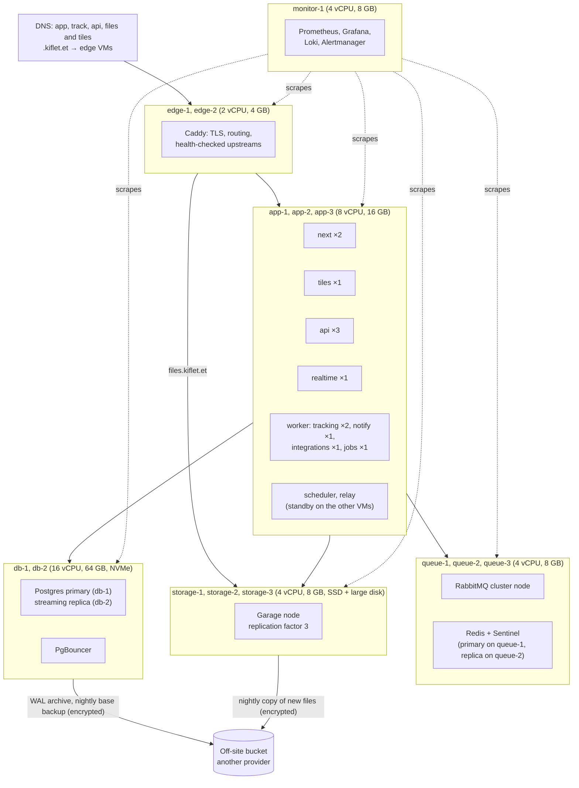

- **Private network** between the VMs; only the edge VMs take traffic from
  the internet. Postgres, Redis and RabbitMQ listen only on the private
  network.
- **Deploys:** CI builds images tagged with the commit; a deploy runs
  `migrate`, then replaces API and worker containers one VM at a time
  (Caddy's health checks take a VM out while it restarts). Next.js deploys
  the same way from Kiflet/web's CI.
- **Backups:** continuous WAL archiving and nightly base backups to the
  off-site bucket with point-in-time restore (pgBackRest or WAL-G), a
  restore tested in CI as `tests/e2e`'s last test does today. RabbitMQ
  definitions exported nightly; Redis needs none. Garage's files are copied
  nightly to the same off-site provider (section 5); Garage's own metadata
  snapshots cover a damaged node, and the setup job below makes its layout
  again on a new one.
- **Garage's setup** is a one-off init container that, through the admin
  API, assigns and applies the layout, makes the buckets and keys, and
  sets CORS and lifecycle rules; it does nothing when they exist already.
  The image is built `FROM scratch` with no shell, so its compose health
  check runs Garage's own binary rather than `wget`.
- **Upgrading Garage** follows its release notes: a major version (v1 to
  v2 reworked the admin API) is a procedure of its own, rehearsed in
  staging with a metadata snapshot first.
- **Staging** is the same compose files with stand-ins for the outside
  world (the provider sandbox, Mailpit, Caddy's own CA), on one VM, as
  `deployments/staging` is now. Garage is not a stand-in: staging runs the
  same image as production, as one node with replication factor 1 (the
  one place that is allowed).
- **Map tiles:** an extract of Ethiopia and the Djibouti corridor in
  Protomaps' PMTiles format, rebuilt monthly from OpenStreetMap, kept in
  Garage and served at `tiles.kiflet.et` by go-pmtiles as `z/x/y` vector
  tiles, cached a day by browsers and phones. The styles, Desk and Night,
  are built from `@kiflet/tokens`. Both clients use them, since
  OpenStreetMap's own tile servers are not for production apps.
- **Smaller to start:** below 2,000 drivers everything fits on three VMs
  (edge+app, queue+db, monitor) with the same compose files, with one
  Garage node on each of the three, so replication factor 3 holds from the
  first day; parts move to their own VMs as load grows, with no code
  change.

---

## 14. Observability

- **Metrics** (Prometheus, `pkg/metrics` rules kept: labels by route or
  queue, never by tenant, user or shipment): request rate, latency and
  errors per route; queue depth, age of the oldest message and consumer
  rate per queue; positions per second in and stored; sync failures by
  reason; outbox lag; SMS sent and failed; Postgres and PgBouncer pools;
  Redis hit rate; Garage's own `/metrics` (on its admin port, with its
  metrics token): requests and errors, blocks waiting to sync, disk used
  per node.
- **Logs:** JSON (zerolog), to Loki, with `request_id` and `trace_id`.
- **Traces:** OpenTelemetry from Next.js through the API, RabbitMQ
  (headers in the envelope) and workers.
- **Alerts** (Alertmanager to the operator by SMS and email): oldest
  message in `tracking.ingest` over 2 minutes; any dead-lettered message;
  outbox lag over 1 minute; 5xx over 1%; replica lag over 30 s; disk over
  80%; backup older than 26 hours; certificate expiring within 14 days;
  a Garage node down or its cluster not healthy; the off-site copy of the
  files older than 26 hours.
- **Health pages:** the operator's System health page reads the same
  figures.

---

## 15. Capacity at 20,000 drivers

The figures the sizing in section 13 comes from. "Peak" assumes 60% of
drivers on the road at once.

| Figure | Estimate |
|---|---|
| Drivers on the road at peak | 12,000 |
| Positions a second, steady | 12,000 ÷ 60 s = **200/s** (one a minute while moving; less when slow or parked) |
| Positions a second, burst | 3,000 phones reconnecting with 2 hours each (120 positions) inside 5 minutes = **1,200/s** for 5 minutes, absorbed by the queue |
| Sync requests a second | 12,000 phones every 60 s = **200/s**; each small (gzip, and only what changed) |
| Positions a day | ~6 million (10 hours of driving each) |
| `tracking_events` size | ~150 bytes a row with indexes → ~0.9 GB a day, **~80 GB** over 90 days before simplification, ~25 GB after |
| Dashboard users online | ~2,000 dispatchers, one WebSocket each |
| Live messages | positions coalesced per tenant to one message every 5 s: under 1,000/s across all sockets |
| SMS | ~10 texts per shipment; 10,000 shipments a day → **100,000 texts a day**, ~5/s at peak, limited by the gateway |
| Photos | 2 per delivery at ~300 KB → ~6 GB a day into object storage |
| Garage disk | 6 GB a day × 3 copies = ~18 GB a day of raw disk across the three nodes: **~2.2 TB of files a year, ~6.6 TB of disk**, so each storage VM needs ~2.2 TB of data disk a year kept (plus the off-site copy, paid by the GB) |

What each part handles at that load, with room to spare:

- **api ×3:** 200 sync/s plus ~500 web requests/s; Go handles several
  thousand simple requests a second per core, so CPU is not the limit;
  Postgres connections are, which is why PgBouncer.
- **tracking workers ×2:** batches of 500 positions with `COPY` store
  10,000+ positions a second each, so a 1,200/s burst drains as fast as it
  comes.
- **RabbitMQ (3 nodes):** a few thousand messages a second is light work
  for quorum queues on modest VMs.
- **Postgres:** ~400 writes a second in batches and indexed reads; the
  primary's NVMe and 64 GB keep the working set (today's partitions and the
  hot tables) in memory.
- **Garage (3 nodes):** ~10,000 deliveries a day is well under one upload a
  second; disk, not CPU, is what it runs out of. How long POD photos are
  kept (a retention setting per company, still to set) decides how fast.

When to grow: more `api` and worker replicas first (no code change); then
a bigger database VM; then, past ~50,000 drivers, positions could move to
their own database (TimescaleDB or a separate Postgres), which the
module boundary already allows.

---

## 16. What is deliberately not in it

- **Microservices now.** Separate services per module would mean separate
  deploys, network calls between modules and distributed transactions, for
  a team this size. The module boundaries and the broker make the split
  possible later for the module that needs it (most likely tracking).
- **Kubernetes.** Docker Compose on VMs, as chosen. The images and health
  checks are the same, so moving later means writing manifests, not
  changing code.
- **A separate database per module, Kafka, event sourcing.** Not needed at
  this scale: Postgres with schemas, RabbitMQ and the outbox do the job
  with fewer moving parts.
- **Redis as a source of truth or as a queue.** RabbitMQ queues work;
  Redis caches.
- **MinIO, SeaweedFS or a hosted S3 for the app's files.** Garage was
  chosen (2026-11-19): self-hosted, small, made for a few nodes on ordinary
  machines. MinIO no longer publishes images; SeaweedFS, which staging and
  the tests ran before, is gone.
- **An API per client** (`/api/web`, `/api/driver`). One API, each
  operation tagged with who may call it, gives each operation one shape and
  one set of tests, whichever client calls it (decided 2026-11-19).
- **GraphQL.** REST with generated types covers both clients; the driver
  sync is a single purpose-built operation.
