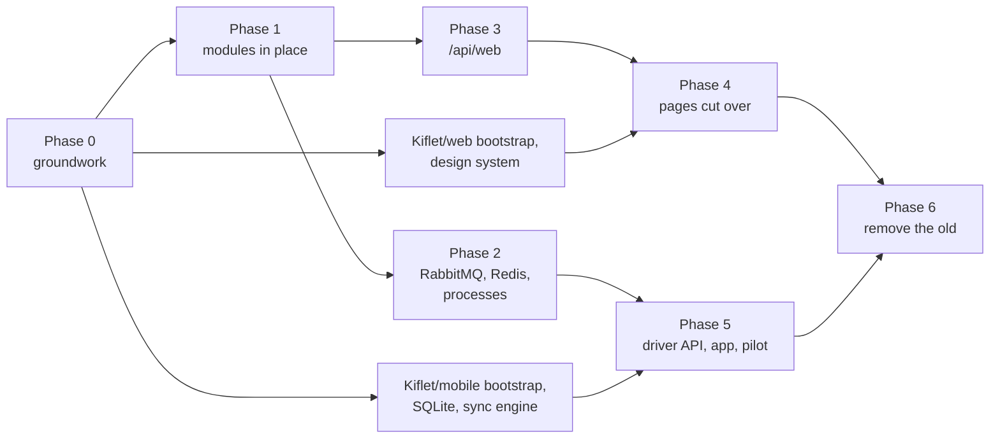

# Migration: from one Go application to three codebases

How to get from today's Kiflet (one Go binary that renders the dashboard,
the public pages and the driver PWA) to the architecture in
`docs/architecture.md`: a modular Go backend with RabbitMQ and Redis in
this repository (**Kiflet/backend**), a Next.js web app in
**[Kiflet/web](https://github.com/Kiflet/web)**, and a React Native (Expo)
driver app in **[Kiflet/mobile](https://github.com/Kiflet/mobile)**.

This document holds the whole plan and the backend's phases in full. The
clients' phases are in their own repositories, step by step:
[Kiflet/web `docs/migration.md`](https://github.com/Kiflet/web/blob/main/docs/migration.md)
(phase 4: every page, in waves, with the API each needs) and
[Kiflet/mobile `docs/migration.md`](https://github.com/Kiflet/mobile/blob/main/docs/migration.md)
(phase 5: from the PWA to the app, the parity checklist, the pilot).

It is written for whoever does the work, step by step, with what each step
produces, how to check it, and how to undo it.

Contents:

1. [Principles](#1-principles)
2. [Where things are today](#2-where-things-are-today)
3. [The end state](#3-the-end-state)
4. [Where everything goes](#4-where-everything-goes)
5. [The phases](#5-the-phases)
   - [Phase 0: groundwork](#phase-0-groundwork)
   - [Phase 1: modules, in place](#phase-1-modules-in-place)
   - [Phase 2: infrastructure: RabbitMQ, Redis, separate processes](#phase-2-infrastructure-rabbitmq-redis-separate-processes)
   - [Phase 3: the web API and its contract](#phase-3-the-web-api-and-its-contract)
   - [Phase 4: the web app](#phase-4-the-web-app)
   - [Phase 5: the driver app](#phase-5-the-driver-app)
   - [Phase 6: removing the old](#phase-6-removing-the-old)
6. [Database changes](#6-database-changes)
7. [Testing through the migration](#7-testing-through-the-migration)
8. [Order, overlap and size](#8-order-overlap-and-size)
9. [Risks](#9-risks)
10. [Still to decide](#10-still-to-decide)

---

## 1. Principles

1. **No big bang.** The current app keeps serving customers the whole
   time. New parts replace old ones one route, one page, one worker at a
   time behind Caddy (the "strangler fig" pattern). At every step `main`
   can be deployed.
2. **One database.** All three codebases use the same PostgreSQL through
   the Go API. There is no data migration between systems, only schema
   changes in place, each backwards-compatible with the version running.
3. **The backend first.** The web and mobile apps need an API to talk to;
   the API needs the modules. So the order is modules, then infrastructure,
   then the API, then the clients. The clients' bootstrapping (repository,
   design system, tooling) can start in parallel.
4. **Parity before removal.** A page or feature is removed from the Go app
   only when the new one does everything it did, checked against
   `docs/E2E_TEST_GUIDE.md` and the tests.
5. **The rules stay in Go.** Business rules (statuses and transitions,
   plan limits, alert conditions, what a role may do) are not rewritten in
   TypeScript. The clients ask the API, as the driver PWA already does with
   `/api/v1/driver/config`.
6. **Same conventions as now.** Tenant scoping in every query; append-only
   events and audit log; words customers read in English and Amharic;
   metrics labels from short fixed lists; no secrets in the repositories;
   `CHANGELOG.md` for every change.

---

## 2. Where things are today

At `main` on 2026-11-18:

- **One Go module** (`github.com/kiflet/backend`), one binary
  (`cmd/server`) that serves everything and runs the background workers in
  goroutines (`internal/app.Run`: live relay, SMS, mail, webhooks, jobs).
- **`internal/service`**: all business rules, ~14,000 lines in 40 files,
  one `Services` struct; **`internal/db`**: sqlc over 34 tables in one
  schema; **`internal/model`**: statuses, transitions, roles, plans.
- **`internal/web`**: chi routes (`server.go`), ~96 routes rendering
  `html/template` pages (53 templates), JSON for the driver app
  (`/api/v1/driver/*`), the public API (`/api/v1/shipments`, `/drivers`),
  provider callbacks (SMS, telebirr, CBE Birr), the WebSocket (`/app/live`).
- **The driver app**: a PWA in `internal/web/static/driver`, 20 ES modules,
  IndexedDB for its offline store, a service worker, `POST
  /api/v1/driver/sync` as its only data call.
- **Background work**: an outbox in tables (`sms_messages`, `emails`,
  `webhook_deliveries`) polled by workers; `Jobs.Run` every minute under a
  Postgres advisory lock (driver, ETA, pickup, route and stop checks,
  billing, plan limits, papers, retention); live updates across instances
  by `LISTEN`/`NOTIFY` (`internal/app/live.go`).
- **Infrastructure**: Docker Compose (`deployments/`), Caddy, PostGIS 15,
  Prometheus and Grafana, S3 storage (SeaweedFS in staging), backups with
  point-in-time restore; staging over HTTPS with the provider sandbox.
- **Tests**: 175 unit, ~100 integration (against PostGIS), 9 end-to-end
  against staging (one drives the driver PWA in headless Chrome).

What already fits the target and must be kept:

- The driver sync protocol: one request, many items, idempotent by
  `client_id`, a cursor. The Expo app uses the same shape.
- The outbox tables and retry schedules for SMS, email and webhooks; they
  become the source for RabbitMQ messages rather than being replaced.
- The provider adapters (`pkg/sms`, `pkg/payments`) and the sandbox.
- The public API, its OpenAPI file and `TestOpenAPIMatchesTheAPI`.
- The design (Desk and Night tokens, Geist, lucide), the words in
  `internal/text`, the E2E guide.

---

## 3. The end state

| Repository | Contains | Deploys as |
|---|---|---|
| **Kiflet/backend** (this one) | Go backend: modules, `cmd/{api,realtime,worker,scheduler,relay,migrate,sandbox}`; migrations; OpenAPI and AsyncAPI contracts; the generated `@kiflet/api` TypeScript client package; `deployments/` for every environment (Caddy, Postgres, PgBouncer, RabbitMQ, Redis, Garage, monitoring); integration tests; the docs | Docker images `ghcr.io/kiflet/backend`, `ghcr.io/kiflet/sandbox`; the `@kiflet/api` npm package |
| **Kiflet/web** | Next.js: the public pages, the dashboard, the operator's pages; the design system; Playwright tests | Docker image `ghcr.io/kiflet/web` |
| **Kiflet/mobile** | Expo app for drivers: SQLite, sync engine, background GPS, screens; Maestro tests | Play Store / App Store builds (EAS Build), over-the-air updates (EAS Update), an APK on the website |

This repository stops serving HTML. Its only HTTP surfaces are `/api/*`,
`/ws`, `/healthz`, `/readyz` and `/metrics`.

---

## 4. Where everything goes

### Directories

| Today | Goes to | Notes |
|---|---|---|
| `cmd/server` | `cmd/api`, `cmd/worker`, `cmd/scheduler`, `cmd/relay`, `cmd/realtime`, `cmd/migrate` | `seed` and `sms-in` stay as subcommands of a `cmd/kiflet` tool |
| `cmd/sandbox`, `internal/sandbox` | stay | |
| `internal/app` | `internal/app` | builds each process from its settings, as now |
| `internal/config` | `internal/platform/config` | gains `RABBITMQ_URL`, `REDIS_URL`, `WEB_ORIGIN` |
| `internal/db` | per module `internal/modules/*/store` | sqlc with one config per module |
| `internal/geo`, `internal/phone` | `internal/platform/geo`, `internal/platform/phone` | |
| `internal/model` | each module's `domain/` | transitions to `shipments/domain`, roles to `identity/domain`, plans to `billing/domain` |
| `internal/service/*.go` | `internal/modules/*/app` | file by file, table below |
| `internal/text` | stays for SMS and email (`internal/platform/text`); page words copied into Kiflet/web's message files | the parity test moves with them |
| `internal/web/server.go`, middleware | `internal/http`: router, auth, CSRF, rate limits, request IDs | |
| `internal/web/api_driver.go` | `internal/modules/*/http` under `/api/driver` | |
| `internal/web/api_public.go` | `internal/modules/*/http` under `/api/v1` | unchanged contract |
| `internal/web/app_*.go`, `public.go` | JSON handlers under `/api/web`; the pages go to Kiflet/web | |
| `internal/web/templates/**` | Kiflet/web `app/**` | page table below; deleted here in phase 6 |
| `internal/web/static/app.css`, `app.js`, `map.js`, fonts, icons | Kiflet/web `styles/`, `components/` | tokens to Tailwind; `map.js` to a MapLibre component |
| `internal/web/static/driver/**` | Kiflet/mobile, rewritten | kept here until the app has replaced it (phase 5) |
| `internal/web/static/openapi.json` | `api/openapi/v1.yaml` | |
| `pkg/sms`, `pkg/payments`, `pkg/mail`, `pkg/storage` | `internal/platform/*` or stay in `pkg` | they are adapters, no rules |
| `pkg/websocket` | `cmd/realtime` | |
| `pkg/metrics`, `pkg/hash`, `pkg/console` | stay | |
| `migrations` | stay | new migrations for schemas, outbox, partitions, push tokens |
| `deployments` | stay, grow | one compose file per VM role (section 13 of the architecture) |
| `tests/integration` | stay | run against the new processes |
| `tests/e2e` | split: API and infrastructure tests stay; browser tests to Kiflet/web (Playwright); driver app tests to Kiflet/mobile | |
| `docs` | stay | E2E guide updated per phase |

### Services to modules

| `internal/service` file(s) | Module |
|---|---|
| `auth.go`, `accounts.go`, `users.go`, `verification.go` | identity (staff and drivers' accounts), fleet (driver profile fields) |
| `tenants.go`, settings parts of `notify.go` | tenancy |
| `vehicles.go`, `papers.go` | fleet |
| `shipment.go`, `shipment_status.go`, `shipment_files.go`, `shipment_import.go`, `dispatch.go`, `convert.go` | shipments |
| `pod.go`, `media.go` | proof |
| `tracking.go`, `sync.go` (positions part) | tracking |
| `sync.go` (the rest) | a `driversync` façade that calls shipments, proof, messaging and tracking |
| `alerts.go`, `alert_rules.go`, the checks in `jobs.go` | alerts |
| `sms.go`, `mail.go`, `notify.go` | notify |
| broadcasts and driver messages (in `dispatch.go` and `sync.go`; the messages are rows in `shipment_events`) | messaging, writing through shipments |
| `shipment_public.go` | customer |
| `billing*.go` | billing |
| `api.go`, `api_json.go`, `webhooks.go` | integrations |
| `reports.go` | reports |
| `support.go` | support |
| `audit.go` | audit |
| `data.go`, retention in `jobs.go` | data |
| `health.go` | platform (operator) |
| `jobs.go` | scheduler (the timer) and each module's job handlers |

### Pages and the driver app's modules

Where each page of the dashboard and the public site goes, with the API
each needs, is the page inventory in
[Kiflet/web `docs/migration.md`](https://github.com/Kiflet/web/blob/main/docs/migration.md#the-page-inventory).
Where each module of the driver PWA goes is in
[Kiflet/mobile `docs/migration.md`](https://github.com/Kiflet/mobile/blob/main/docs/migration.md#the-pwa-module-by-module).

---

## 5. The phases

Each phase lists its steps, what done looks like, and how to roll back.

### Phase 0: groundwork

Decisions and accounts, before code moves.

1. **Repositories.** Done on 2026-11-19: the GitHub organization
   [Kiflet](https://github.com/Kiflet) with `backend` (this repository,
   moved there with its whole history and the `v0.9.0` tag; the Go module
   is now `github.com/kiflet/backend`), `web` and `mobile`, all public under
   the same licence. Still to do in the organization's settings: branch
   protection on each `main` (CI must pass), two-factor authentication for
   members, a second owner, private vulnerability reporting, and archiving
   the old `Natnael-Alemayehu/kiflet` repository with a pointer here.
2. **Accounts.** Expo (EAS Build and Update), Google Play Console, Apple
   Developer Program (when iOS is wanted), Firebase project for FCM (push
   on Android), GitHub Packages for `@kiflet/api`.
3. **Domains.** `app.kiflet.et` (dashboard), `track.kiflet.et` or
   `kiflet.et/track` (public pages; the short form matters in SMS),
   `api.kiflet.et` (public API, same backend). Today everything is one
   host; tracking links already sent by SMS must keep working (redirects).
4. **Contracts tooling** (in this repository):
   - OpenAPI 3.1 files under `api/openapi/` (`web.yaml`, `driver.yaml`,
     `v1.yaml`).
   - Go: `oapi-codegen` generating request and response types and a
     strict server interface per API, which the module handlers implement.
   - TypeScript: `openapi-typescript` for types and `openapi-fetch` for the
     client, packaged as `@kiflet/api` with a version per release of this
     repository.
   - CI: lint the specs, regenerate and fail on a diff (as `sqlc diff`
     does), publish the package on a tag.
5. **Conventions written down** in each new repository's `AGENTS.md` and
   `CONTRIBUTING.md`: the same rules (tenant first, text in both
   languages, no inline scripts, CHANGELOG), plus their own (TypeScript
   strict, ESLint, Prettier, no `any`).

Done when: both repositories exist with CI that builds an empty app, and
this repository's CI publishes a first `@kiflet/api` from the public API's
spec.

Roll back: nothing to roll back; no code has moved.

### Phase 1: modules, in place

Reorganise this repository into the modules of the architecture without
changing behaviour. The server-rendered dashboard and the PWA keep working
throughout; only imports move.

1. **Platform packages first:** move `config`, `geo`, `phone`, `text`,
   `storage`, `mail`, `sms`, `payments` under `internal/platform/` (or keep
   `pkg/` where it is, see ROADMAP "Considered and not planned"). One
   commit, `go build ./...` and all tests green.
2. **One module at a time**, in this order (fewest dependencies first):
   audit → tenancy → identity → fleet → shipments → proof → tracking →
   messaging → customer → notify → alerts → integrations → billing →
   reports → support → data. For each:
   1. Create `internal/modules/<name>/` with `<name>.go` (the interface),
      `app/`, `domain/`, `store/`.
   2. Move its `service` code into `app/`, its rules from `model` into
      `domain/`, its queries from `sqlc/queries` into `store/queries/`, with
      an sqlc config per module (`sqlc.yaml` gains one entry per module).
   3. Replace calls from other modules into its internals with calls
      through its interface. Where a module would call one that depends on
      it, publish an event instead (in this phase, an in-process event bus
      with the same interface the RabbitMQ one will have).
   4. Move its handlers from `internal/web/app_*.go` next to it under
      `http/` (still rendering templates for now).
   5. `make test test-integration`; one PR per module.
3. **A test that enforces the boundaries:** `go list -deps` per module;
   a module may import only `internal/platform/*`, its own packages and
   other modules' root packages (their interfaces), never their `app/` or
   `store/`. Like the sandbox's import test today.
4. **Events, in process:** an `events.Bus` interface (`Publish(ctx, tx,
   Event)`, `Subscribe(type, handler)`) with an in-memory implementation
   that runs handlers after the transaction commits. Alerts, notify,
   webhooks and live updates subscribe to it instead of being called
   directly.

Done when: `internal/service`, `internal/model` and `internal/db` are gone;
every module has the layout of the architecture's section 4; the boundary
test passes; nothing a user sees has changed.

Roll back: each module is one PR; revert it.

### Phase 2: infrastructure: RabbitMQ, Redis, separate processes

1. **Compose files.** Add RabbitMQ (`rabbitmq:4-management`, quorum
   queues) and Redis (`redis:8`, AOF) to `deployments/dev/compose.yml`,
   staging and production; PgBouncer in front of Postgres. The exchanges
   and queues are declared by the app at start (`pkg/broker`'s
   `Topology`), so a new queue ships with the code that uses it. `make db`
   starts Postgres, RabbitMQ and Redis. RabbitMQ and Redis: done.
2. **Postgres 15 → 17** (PostGIS 3.6): a dump and restore, as
   `docs/deploy.md` ("Upgrading PostgreSQL") has it, while the database is
   small; a database too big to restore in a maintenance window would use
   `pg_upgrade --link` or a logical replica and a switch. Tested by
   staging's restore test.
3. **The broker package** (`pkg/broker` until phase 1 moves the platform
   packages; done): connection with
   reconnects, channels per goroutine, publisher confirms, the envelope,
   consumers with prefetch, ack after commit, retries through delayed
   dead-letter queues, metrics per queue. The `events.Bus` from phase 1
   gets a RabbitMQ implementation.
4. **The outbox:** migration for `outbox` (id, type, version, tenant_id,
   routing_key, payload jsonb, created_at, sent_at), written in the same
   transaction as each change; `cmd/relay` publishes and marks sent
   (`LISTEN outbox` to wake, `FOR UPDATE SKIP LOCKED`, leader by advisory
   lock); `processed_messages` for consumers' idempotency. Done, with the
   relay inside the app (`internal/app/relay.go`) until step 9 makes it a
   process of its own; shipment events are written to it.
5. **Move the workers to queues, one at a time,** each behind a setting
   so it can be switched back:
   1. Webhooks (`webhook.deliver`), keeping `webhook_deliveries` as the
      record and its retry schedule.
   2. Email (`notify.email`).
   3. SMS (`notify.sms`), rate-limited by prefetch to the gateway's limit.
   4. Alerts evaluation from events (`alerts.evaluate`).
   5. Audit writes (`audit.write`).
   6. Live updates: `kiflet.live` exchange replaces `LISTEN`/`NOTIFY`
      (`internal/app/live.go`). Done (`WORKER_LIVE`).
   7. Timed jobs: `cmd/scheduler` publishes to `jobs.scheduled` on the
      schedule `Jobs.Run` keeps today; the jobs worker runs them.
6. **Positions through the queue:** the sync handler publishes positions
   to `tracking.ingest` (with confirms) instead of inserting them; the
   tracking worker batch-inserts, updates `driver_positions` and Redis,
   runs the stop, route and arrival checks, publishes events. The response
   to the phone keeps its shape (`locations_stored` becomes "accepted").
   Done for the inserts and `driver_positions` (`WORKER_TRACKING`); Redis
   and the checks move into the worker with steps 8 and 5.4.
7. **Partition `tracking_events`** by day (section 6 of this document).
8. **Redis:** session, driver-token and API-key lookups cached; rate
   limits in Redis (Caddy's sticky routing becomes unnecessary); latest
   positions and presence for the fleet map; tenant data cache with
   deletion on change. Redis in the compose files and the rate limits:
   done (`internal/web/limits.go`, falling back to each instance's own
   count).
9. **Separate processes:** `cmd/api` (HTTP), `cmd/realtime` (WebSocket),
   `cmd/worker --queues=tracking.*` and so on, `cmd/scheduler`,
   `cmd/relay`, `cmd/migrate`. `cmd/server` stays for one release as "all
   of them in one process" for development and small installs.
10. **Garage for files** (architecture, section 5). It depends on nothing
    else in this phase and can go first:
    1. `pkg/storage`: an `S3_FORCE_PATH_STYLE` setting (today path-style
       is used only for `http://` endpoints), and the public endpoint
       that presigned URLs are signed for, apart from the private one the
       app uploads through.
    2. Compose: Garage (`dxflrs/garage`, pinned) in `deployments/dev`,
       staging (one node, replication factor 1, replacing SeaweedFS) and
       production (three nodes, factor 3), with `garage.toml` in
       `deployments/garage/` and `rpc_secret` and the admin token as
       secret files (`GARAGE_RPC_SECRET_FILE`, `GARAGE_ADMIN_TOKEN_FILE`).
       A `garage-init` job applies the layout and makes the buckets, keys,
       CORS and lifecycle rules through the admin API, and is safe to run
       again. The health check uses Garage's binary (the image has no
       shell).
    3. Caddy: `files.kiflet.et` (staging: `files.kiflet.localhost`) to
       Garage's S3 port only, with phase 5's presigned uploads, the first
       to need the store reachable from outside: until then the app
       carries every file itself.
    4. Tests: `tests/integration/storage_test.go` starts Garage instead of
       SeaweedFS, and adds presigned PUT and GET, CORS and a lifecycle
       rule; staging's end-to-end delivery test then runs against it.
    5. The bucket in the nightly encrypted backup to the off-site bucket
       (`scripts/backup.sh` with rclone, as for the database: the
       `_objects` archive), restored by `scripts/restore.sh`, in
       `tests/e2e`'s restore test.
    6. Production: copy the files already stored (the `app-data` volume,
       or the S3 bucket if `STORAGE_TYPE=s3`) into Garage with
       `rclone copy --checksum`, switch the settings, keep the old copy a
       month.
11. **Load test** in staging (k6): 12,000 simulated phones syncing every
    60 s, then 3,000 reconnecting with 2 hours of positions each; the
    targets in the architecture's section 15 (oldest message in
    `tracking.ingest` under 2 minutes, API p95 under 300 ms).

Done when: production runs the separate processes on RabbitMQ and Redis;
the load test passes; stopping Redis or one RabbitMQ node in staging loses
nothing (tested); the old in-process workers are deleted; files are in
Garage, with one node of production's three stopped for an hour losing
nothing and refusing no upload, and a file restored from the off-site copy.

Roll back: each worker move has a setting (`WORKER_<NAME>=inprocess|queue`)
until it has run in production for two weeks; Redis can be turned off
(`REDIS_URL` empty falls back to Postgres and per-instance limits); the
files stay where they were until Garage has run a month, so going back
is the old settings and a copy of what was uploaded since.

### Phase 3: the web API and its contract

The dashboard today renders HTML from handlers. Kiflet/web needs the same
data and actions as JSON. Build `/api/web` module by module, in the order
the pages will move (phase 4).

1. **For each page in the page table**, list what it reads and what forms
   it posts; that is its endpoints. For example the shipment page:
   - `GET /api/web/shipments/{id}` (shipment, driver, vehicle, customer,
     progress, POD summary)
   - `GET /api/web/shipments/{id}/events` (the activity)
   - `GET /api/web/shipments/{id}/trail` (exists as
     `/app/shipments/{id}/trail` since PR #46)
   - `GET|POST|DELETE /api/web/shipments/{id}/documents…`,
     `…/charges…`
   - `POST /api/web/shipments/{id}/status|assign|unassign|cancel|reopen|note`
   - `POST /api/web/shipments/{id}/pods/{pod}/accept|dismiss`
2. **Write the spec first** in `api/openapi/web.yaml`, generate, implement
   the handler by calling the module's use case (the same one the HTML
   handler calls), and test it in `tests/integration` (status codes,
   tenant isolation, roles, validation errors).
3. **Auth for the web:** the session cookie set by `POST /api/web/session`
   (sign in), `DELETE /api/web/session` (sign out), `GET /api/web/me` (who,
   tenant, role, what they may do, feature flags). CSRF: double-submit
   token in a header (`X-CSRF-Token`) checked by the API.
4. **What the server decides, the API says.** Each response carries what
   the user may do with it (`"actions": ["assign", "cancel"]`) so the web
   doesn't reimplement roles or transitions.
5. **Lists:** cursor pagination, filters and sort as query parameters,
   the same filters as today's shipment list and saved views.
6. **Errors:** one shape, field errors keyed by field name, messages in
   the user's language.
7. **Publish** `@kiflet/api` with each tagged release.

Done when: every page in the page table has its endpoints, specified,
implemented and tested; the HTML handlers still work (they can call the
same use cases).

Roll back: additive only; nothing uses the new endpoints until phase 4.

### Phase 4: the web app

Built in [Kiflet/web](https://github.com/Kiflet/web); its
`docs/migration.md` has the steps (the empty app, the design system, the
shell and sessions), the nine waves of pages, the inventory of every page
with the endpoints it needs, and the parity checks before a page moves.

What this repository does in phase 4:

1. **Endpoints first.** Build each wave's `/api/web` endpoints (phase 3)
   before Kiflet/web needs them, in the waves' order.
2. **Routing in Caddy.** `deployments/Caddyfile` sends each page's paths
   to the Next.js service once the page passes its parity checks, and
   everything else to the Go app. One PR per wave, so a wave can be moved
   back by reverting it.
3. **One session for both.** The backend sets the session cookie on the
   shared host, so a user crosses between a Go page and a Next.js page
   without signing in again; a test here checks it.
4. **Feature freeze on the Go pages** from the first wave: fixes only;
   new dashboard features are built in Kiflet/web.
5. **Delete each Go template** a week after its page moved with no
   regression, with its HTML handler and its page tests, one PR each.

Done when: Caddy sends every non-API path to Next.js; the Go app serves no
HTML.

Roll back: per wave, in Caddy, until the templates are deleted.

### Phase 5: the driver app

Built in [Kiflet/mobile](https://github.com/Kiflet/mobile); its
`docs/migration.md` has the steps (accounts and the app's permanent
identifiers, the empty app, the database and the sync engine, screens,
background GPS, delivery and uploads, the pilot, moving every driver), the
PWA module by module, and the parity checklist. The app can start against
today's `/api/v1/driver/*` before any of the changes below.

What this repository does in phase 5:

1. **Driver API changes** (`/api/driver`, keeping `/api/v1/driver/*`
   working for the PWA):
   - `POST /api/driver/uploads` returns presigned PUT URLs for photos and
     signatures; `SyncPOD` accepts storage keys instead of inline data
     (inline still accepted for the PWA).
   - `POST /api/driver/push-token` (Expo push token, platform); a
     `push_tokens` table; notify sends push for new loads, changes and
     messages.
   - `X-App-Version` header; `426 Upgrade Required` below the minimum
     supported version, set in config.
   - The sync request and response stay the same shape, specified in
     `api/openapi/driver.yaml`.
2. **Which app each driver uses:** the device's app (PWA or the new app)
   and version on the dashboard's driver page, from the sync request.
3. **The PWA stays** served from `internal/web/static/driver` until no
   active driver has used it for 30 days; then phase 6 removes it.

Done when: every active driver uses the new app, and positions keep
coming with the screen locked.

Roll back: drivers can sign in to the PWA again at any time until it is
removed; the API serves both.

### Phase 6: removing the old

1. Delete `internal/web/templates`, the HTML handlers, `static/` (the
   dashboard's CSS and JS, the PWA), `internal/web/driver.go`, and the
   tests that rendered pages (`go test ./internal/web/` parsing templates;
   `TestDriverBuild`).
2. Delete `cmd/server`'s all-in-one mode if no installation uses it, or
   keep it documented for development.
3. Drop what only the old code used: inline POD data in sync,
   `/api/v1/driver/*` (after the last PWA driver), the `LISTEN`/`NOTIFY`
   relay.
4. Update `README.md`, `AGENTS.md`, `CONTRIBUTING.md`, `docs/deploy.md`,
   `docs/E2E_TEST_GUIDE.md` (now spanning three repositories), and record
   the change in `CHANGELOG.md`. Delete this document's finished phases,
   as ROADMAP does.

---

## 6. Database changes

All migrations are goose files here, rerunnable, and backwards-compatible
with the version deployed before them.

| Change | Phase | How, without downtime |
|---|---|---|
| Module schemas (`shipments`, `tracking`…) | 1, at the end | `ALTER TABLE … SET SCHEMA` is instant; for one release set `search_path` to include every schema so old and new code both find the tables; then qualify names in queries and drop the `search_path` change |
| `outbox`, `processed_messages` | 2 | new tables; nothing reads them until the relay starts |
| `tracking_events` partitioned by day | 2 | create `tracking.tracking_events_p` partitioned, with partitions for the last 90 days and the next 7; write new positions to it (the tracking worker); copy older rows in batches by day in a background job; when the copy is done, swap names in one transaction and keep the old table for a week before dropping it. Retention then drops partitions. |
| `driver_positions` GiST index, BRIN on `recorded_at` | 2 | `CREATE INDEX CONCURRENTLY` |
| Row-level security policies | 2 or 3 | add policies with `FORCE ROW LEVEL SECURITY` off, set `app.tenant_id` in every transaction, check in staging that nothing is refused, then turn it on table by table |
| `push_tokens`, app version per device | 5 | new table, new column with a default |
| Drop inline POD columns or fields, the PWA's tables if any | 6 | after the last PWA driver |
| Postgres 15 → 17 | 2 | staging first, then production (phase 2, step 2) |

The append-only triggers on `shipment_events` and `audit_logs` move with
their tables and keep working; `purgeTx` stays in the data module.

---

## 7. Testing through the migration

| Level | Where | What changes |
|---|---|---|
| Unit | each repository | Go modules keep theirs; TypeScript code gets Vitest (web) and Jest (mobile) |
| Integration | this repository, `tests/integration` | grows with `/api/web` and `/api/driver` endpoints; runs the separate processes with RabbitMQ and Redis in Docker; adds failure tests: Redis stopped, a RabbitMQ node stopped, a consumer crashing mid-batch (no loss, no duplicates) |
| Contract | this repository's CI | the OpenAPI specs match the handlers (as `TestOpenAPIMatchesTheAPI` now, for all three APIs); generated code has no diff |
| Browser end-to-end | Kiflet/web, Playwright | the E2E guide's web sections, against a backend started from this repository's compose files at a pinned image tag |
| App end-to-end | Kiflet/mobile, Maestro | the E2E guide's driver sections, on an Android emulator, against staging |
| Staging | all three | staging runs the backend images, the web image and a preview build of the app; this repository's `tests/e2e` keeps the backup restore and monitoring tests |
| Load | staging, k6 | phase 2's load test, run again before each phase's cut-over |

Each repository's CI runs its own tests on every PR. A change across
repositories (a new endpoint and the page that uses it) lands in this
repository first, releases `@kiflet/api`, then the web or mobile PR bumps
the package.

---

## 8. Order, overlap and size

Rough sizes for one experienced full-time developer (two in parallel
shorten it by about a third, with web and mobile split between them):

| Phase | Size |
|---|---|
| 0: groundwork | 1 week |
| 1: modules in place | 3–4 weeks |
| 2: RabbitMQ, Redis, Garage, processes, partitions, load test | 5–6 weeks |
| 3: `/api/web` for every page | 4–6 weeks (overlaps phase 4) |
| 4: Kiflet/web, ~45 pages | 8–10 weeks |
| 5: Kiflet/mobile and the pilot | 6–8 weeks, plus the pilot's length |
| 6: removal and docs | 1 week |

About **6 to 8 months** for one developer. These are estimates from the
size of the code today, not commitments.

### Against the roadmap

`ROADMAP.md`'s "Toward the first paying customer" does not wait for this.
The provider onboarding, the Amharic review and the pilot with one company
can run on today's app while phases 0–2 happen underneath it; none of
those phases changes what a user sees. The one roadmap item this replaces
is **"Tracking with the screen off"** (a Capacitor wrapper): Kiflet/mobile
does that natively. If a pilot needs screen-off tracking before phase 5,
starting phase 5 early (with the current `/api/v1/driver` API) is better
than a Capacitor wrapper that would be thrown away.

---

## 9. Risks

| Risk | What it would cost | What reduces it |
|---|---|---|
| Two dashboards to maintain during phase 4 | features land twice or wait | freeze new dashboard features in Go once phase 4 starts; new features go only to Kiflet/web |
| Rules drift into TypeScript | a role or transition behaves differently on web | the API returns allowed actions; review checklist item; no status logic in clients |
| Background GPS policies (Play, Android vendors killing services) | gaps in trails | foreground service with notification; tested on the cheap phones drivers use (Tecno, Itel, Samsung A); gaps drawn honestly on the maps (PR #46) |
| RabbitMQ or Redis misconfigured in production | lost or duplicated messages, slow pages | quorum queues, confirms, idempotent consumers; failure tests in CI; staging identical to production |
| The partition migration of `tracking_events` | a slow or failed copy on a big table | copy by day in the background, swap in one transaction, keep the old table a week |
| Garage has no versioning or object lock | a POD photo deleted by a bug or a stolen key can't be brought back from Garage | one key per process with the fewest rights; the nightly encrypted copy to an off-site bucket that keeps versions; an alert when that copy is late |
| Garage is younger and smaller than S3 | a bug or a breaking upgrade (v1 → v2 reworked its admin API) | pin the image; upgrade in staging first with a metadata snapshot; only the S3 API is used by the app, so another S3-compatible store can replace it with settings and a copy |
| Operating more moving parts on VMs | more to monitor and back up | the alerts in the architecture's section 14; runbooks in `docs/deploy.md` for each part |
| Breaking changes to `/api/driver` | old apps on phones fail | version header, `426`, support two releases, tests against the previous app version |
| Cost of accounts and services | Apple's yearly fee, EAS plans, more VMs | start Android-only; EAS's free tier until builds are frequent; three VMs until load needs more |

---

## 10. Still to decide

Questions this plan doesn't settle, for when they come up:

1. **iOS:** at the same time as Android, or later? Android-only halves the
   store work and the testing; most drivers use Android.
2. **The off-site bucket's provider.** The app's files are in Garage on
   our VMs (decided 2026-11-19), but the backups and the copy of the files
   must leave our VMs (a ROADMAP requirement for the pilot): which
   provider, with versioning or object lock?
3. **The public pages' address:** `track.kiflet.et` or `kiflet.et/track`
   (shorter in SMS)?
4. **Who builds what:** if a web or mobile developer joins, phases 4 and 5
   can run in parallel with phase 2.
5. **How long POD photos are kept,** which decides the storage VMs' disks
   (architecture, section 15).
