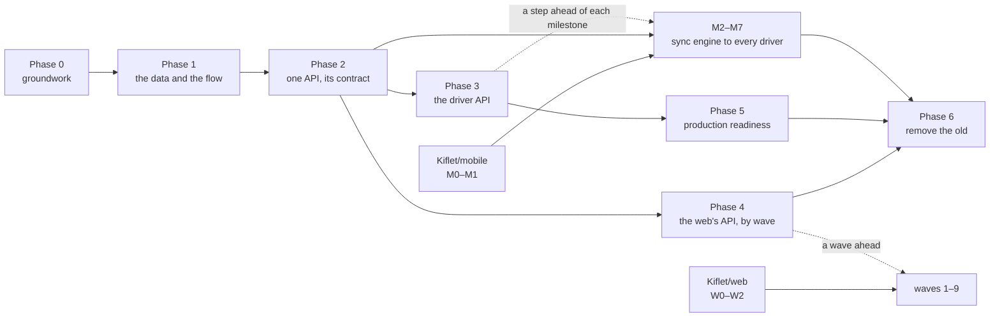

# Migration: from one Go application to three codebases

How to get from today's Kiflet (one Go program that renders the dashboard,
the public pages and the driver PWA) to the architecture in
`docs/architecture.md`: a modular Go backend with RabbitMQ and Redis in
this repository (**Kiflet/backend**), serving one versioned API; a Next.js
web app in **[Kiflet/web](https://github.com/Kiflet/web)**; and a React
Native (Expo) driver app in **[Kiflet/mobile](https://github.com/Kiflet/mobile)**.

The plan was revised on 2026-11-19 after the audit in
`docs/audit-2026-11-19.md`: backend first, with the data and the flows
right before anything is built on them; one API for every client instead
of one per client; and the driver API before the web's, since the driver
app goes first.

This document holds the whole plan and the backend's phases in full. The
clients' steps are in their own repositories:
[Kiflet/mobile `docs/migration.md`](https://github.com/Kiflet/mobile/blob/main/docs/migration.md)
(from the PWA to the app, milestones M0 to M7, alongside phase 3) and
[Kiflet/web `docs/migration.md`](https://github.com/Kiflet/web/blob/main/docs/migration.md)
(every page, in waves, with the operations each needs, alongside phase 4).

It is written for whoever does the work, step by step, with what each step
produces, how to check it, and how to undo it.

Contents:

1. [Principles](#1-principles)
2. [Where things are today](#2-where-things-are-today)
3. [The end state](#3-the-end-state)
4. [Where everything goes](#4-where-everything-goes)
5. [How a module moves](#5-how-a-module-moves)
6. [The phases](#6-the-phases)
   - [Phase 0: groundwork](#phase-0-groundwork)
   - [Phase 1: the data and the flow](#phase-1-the-data-and-the-flow)
   - [Phase 2: one API and its contract](#phase-2-one-api-and-its-contract)
   - [Phase 3: the driver API, with Kiflet/mobile](#phase-3-the-driver-api-with-kifletmobile)
   - [Phase 4: the web's API, with Kiflet/web](#phase-4-the-webs-api-with-kifletweb)
   - [Phase 5: production readiness](#phase-5-production-readiness)
   - [Phase 6: removing the old](#phase-6-removing-the-old)
7. [Database changes](#7-database-changes)
8. [Testing through the migration](#8-testing-through-the-migration)
9. [Order, overlap and size](#9-order-overlap-and-size)
10. [Risks](#10-risks)
11. [Still to decide](#11-still-to-decide)

---

## 1. Principles

1. **No big bang.** The current app keeps serving the whole time. New
   parts replace old ones one route, one page, one worker at a time behind
   Caddy (the "strangler fig" pattern). At every step `main` can be
   deployed.
2. **One database.** All three codebases use the same PostgreSQL through
   the Go API. There is no data migration between systems, only schema
   changes in place, each backwards-compatible with the version running.
3. **Backend first.** The data and the flows come first: a schema that
   refuses a wrong reference, a sync that can't miss a change, one contract
   for every client. The clients are built against that contract and
   adjusted to it, not the other way round. Their bootstrapping
   (repository, design system, tooling) runs in parallel.
4. **One API.** Every client uses the same versioned API, `/api/v1`:
   Kiflet/web with its session, Kiflet/mobile with its driver token,
   companies' systems with API keys. An operation is built once, with one
   shape and one set of tests (`docs/architecture.md`, section 11).
5. **The backend serves no pages in the end.** The Go pages and the driver
   PWA are frozen from 2026-11-19: fixes, and only what the pilot needs.
   New features are operations of the API, shown by the clients.
6. **Parity before removal, tests before deletion.** A page or the PWA is
   removed only when its replacement does everything it did (checked
   against `docs/E2E_TEST_GUIDE.md`), and only once the flows its tests
   covered are tested through the modules and the API (section 8).
7. **The rules stay in Go.** Business rules (statuses and transitions,
   plan limits, alert conditions, what a role may do) are not rewritten in
   TypeScript. Each record comes with what its reader may do with it, and
   each code with its words in the reader's language.
8. **Same conventions as now.** Tenant scoping in every query; append-only
   events and audit log; words customers read in English and Amharic;
   metrics labels from short fixed lists; no secrets in the repositories;
   `CHANGELOG.md` for every change.

---

## 2. Where things are today

At `main` on 2026-11-19 (`dcd7225`; the figures are the audit's):

- **One Go module** (`github.com/kiflet/backend`), 49,700 lines; one
  program (`cmd/server`) run in roles (`serve --roles=web,worker,
  scheduler,relay`), so the web server, the queue workers, the scheduler
  and the outbox relay run in one container or several.
- **Modules moved:** audit, tenancy, identity and fleet; shipments in part
  (its tables, its history, which it records and publishes on the bus, the
  status rules, documents and charges). 13,100 lines of rules are still in
  `internal/service`, with `internal/db` (sqlc) and `internal/model`.
  `internal/modules/boundaries_test.go` keeps the moved modules from
  reaching back.
- **The events bus** (`internal/platform/events`): subscribers run within a
  change's transaction (webhooks, alerts, texts) or after it commits (live
  updates); shipment events are written to `event_outbox`, and with
  RabbitMQ published to `kiflet.events`.
- **Infrastructure:** RabbitMQ and Redis in every compose file; webhooks,
  e-mail, SMS, live updates, timed jobs and GPS positions through queues,
  each with a setting to run in process instead (`WORKER_*`), and the app
  still working without RabbitMQ; rate limits in Redis; Postgres 17 with
  PostGIS 3.6; `tracking_events` partitioned by day; Garage for files, on
  one node; a load test written and run at small scale.
- **`internal/web`:** about 96 routes render pages (53 templates); JSON for
  the driver PWA (`/api/v1/driver/*`); the public API (8 operations under
  `/api/v1`); the providers' callbacks; the live socket (`/app/live`).
- **The driver app:** a PWA in `internal/web/static/driver`, ES modules
  with IndexedDB and a service worker; `POST /api/v1/driver/sync` is its
  only data call.
- **Tests:** 210 unit, 127 integration, 9 end to end on staging. Of the 484
  request paths written in the integration tests, 427 are Go pages.
- **Kiflet/web and Kiflet/mobile:** their plans (architecture, design,
  migration); no code yet.

What already fits the target and is kept:

- The sync's write side: one request with many items, idempotent by
  `client_id`, the phone's clock corrected, the office's decision winning
  over a stale update, a delivery never thrown away.
- The outbox tables and retry schedules for SMS, e-mail and webhooks, now
  fed to RabbitMQ.
- The provider adapters (`pkg/sms`, `pkg/payments`) and the sandbox.
- The design (Desk and Night tokens, Geist, lucide), the words in
  `internal/platform/text`, the E2E guide.

---

## 3. The end state

| Repository | Contains | Deploys as |
|---|---|---|
| **Kiflet/backend** (this one) | Go backend: the modules; one program with its roles (`api`, `realtime`, `worker`, `scheduler`, `relay`) and `migrate`; migrations; the contracts (`api/openapi/v1.yaml`, `api/asyncapi/*.yaml`) and the `@kiflet/api` package generated from them; `deployments/` for every environment; integration and end-to-end tests of the API; the docs | Docker images `ghcr.io/kiflet/backend` and `ghcr.io/kiflet/sandbox`; the `@kiflet/api` npm package |
| **Kiflet/web** | Next.js: the public pages, the dashboard, the operator's pages; the design tokens (`@kiflet/tokens`); Playwright tests | Docker image `ghcr.io/kiflet/web` |
| **Kiflet/mobile** | The Expo driver app: its own SQLite database holding the driver's work, the sync engine, background GPS, the screens; Maestro tests | Play Store and App Store builds (EAS Build), over-the-air updates (EAS Update), an APK on the website |

This repository stops serving HTML. Its only HTTP surfaces are `/api/v1/*`
(the one API), `/api/callbacks/*` (the providers), `/ws` (live updates),
`/healthz`, `/readyz` and `/metrics`.

---

## 4. Where everything goes

### Directories

| Today | Goes to | Notes |
|---|---|---|
| `cmd/server` | stays, run in roles | the roles are done |
| `cmd/sandbox`, `internal/sandbox` | stay | |
| `internal/app` | stays | builds each role from its settings, as now |
| `internal/db` | each module's `internal/modules/*/store` | sqlc with an entry per module |
| `internal/model` | each module's `domain/` | transitions to `shipments/domain` and roles to `identity/domain` (done), plans to `billing/domain` |
| `internal/service/*.go` | `internal/modules/*/app` | file by file (table below), each when its part of the API is built |
| `internal/web/server.go`, middleware | `internal/http`: router, who is calling, the cross-origin check, rate limits, request IDs, idempotency | |
| `internal/web/api_driver.go` | `internal/modules/*/http`, under `/api/v1/driver` | |
| `internal/web/api_public.go` | `internal/modules/*/http`, under `/api/v1` | its 8 operations take the API's conventions in phase 2 |
| `internal/web/app_*.go`, `public.go` | the API's operations, in `internal/modules/*/http`; the pages go to Kiflet/web | the HTML handlers are deleted with their pages, not moved |
| the providers' callbacks (`/api/v1/sms/*`, `/api/v1/payments/*`) | `/api/callbacks/*` | done in phase 2, before any provider was given an address |
| `internal/web/templates/**` | Kiflet/web `app/**` | deleted here as pages move (phase 4) |
| `internal/web/static/app.css`, `app.js`, `map.js`, fonts, icons | Kiflet/web (`@kiflet/tokens`, components) | the tokens' starting values |
| `internal/web/static/driver/**` | Kiflet/mobile, rewritten | frozen; kept until no driver uses it (phase 6) |
| `internal/web/static/openapi.json` | `api/openapi/v1.yaml` | the published document shows the operations API keys reach |
| `pkg/sms`, `pkg/payments`, `pkg/mail`, `pkg/storage`, `pkg/broker` | stay in `pkg` | adapters, no rules (ROADMAP, "Considered and not planned") |
| `pkg/websocket` | the `realtime` role | |
| `pkg/metrics`, `pkg/hash`, `pkg/console` | stay | |
| `migrations` | stay | |
| `deployments` | stay, grow | one compose file per VM role (architecture, section 13); a compose file for the clients' tests |
| `tests/integration` | stay | tests of the API and the protocol; page tests go with their pages (section 8) |
| `tests/e2e` | stay, through the API | browser tests go to Kiflet/web (Playwright), the driver app's to Kiflet/mobile (Maestro); the backup restore and monitoring tests stay |
| `docs` | stay | the E2E guide updated as flows move |

### Services to modules

| `internal/service` file(s) | Module | Moves in |
|---|---|---|
| `sync.go` (the protocol, the feed, the devices) | driversync: the driver app's sync, calling shipments, proof, messaging and tracking | phase 1 (the feed), phase 3 |
| `pod.go`, `media.go` | proof | phase 3 |
| `tracking.go`, `sync.go` (positions) | tracking | phase 3 |
| broadcasts and driver messages (`dispatch.go`, `sync.go`; the messages are rows in `shipment_events`) | messaging, writing through shipments | phase 3 |
| `sms.go`, `mail.go`, `notify.go`; push, which is new | notify | phase 3 (push), phase 4 (wave 7) |
| `shipment.go`, `shipment_status.go`, `shipment_files.go`, `shipment_import.go`, `dispatch.go`, `convert.go` | shipments | phase 3 (moves from the driver), phase 4 (wave 5) |
| `auth.go`, `accounts.go`, `users.go`, `verification.go` | identity (the rest), fleet (driver profile fields) | phase 3 (the driver's sign-in, devices), phase 4 (waves 2 to 4) |
| `shipment_public.go` | customer | phase 4, wave 1 |
| `reports.go`, and the read models in `sqlc/queries` | reports | phase 4, waves 3 and 6 |
| `support.go` | support | phase 4, wave 3 |
| `alerts.go`, `alert_rules.go`, the checks in `jobs.go` | alerts | phase 4, wave 7 |
| `api.go`, `api_json.go`, `webhooks.go` | integrations | phase 4, wave 7 |
| `billing*.go` | billing | phase 4, wave 7 |
| `tenants.go`, the settings parts of `notify.go` | tenancy (the rest) | phase 4, wave 7 |
| `data.go`, retention in `jobs.go` | data | phase 4, wave 7 |
| `health.go` | platform (the operator's) | phase 4, wave 8 |
| `jobs.go` | the scheduler and each module's job handlers | with each module |

Moved already: audit, tenancy, identity, fleet, and shipments' tables,
history, rules, documents and charges.

### Pages and the driver app's modules

Where each page goes, with the operations it needs, is the page inventory
in [Kiflet/web `docs/migration.md`](https://github.com/Kiflet/web/blob/main/docs/migration.md#8-the-page-inventory).
Where each module of the driver PWA goes is in
[Kiflet/mobile `docs/migration.md`](https://github.com/Kiflet/mobile/blob/main/docs/migration.md#the-pwa-module-by-module).

---

## 5. How a module moves

1. Create `internal/modules/<name>/` with `<name>.go` (its interface),
   `app/`, `domain/`, `store/`, and `http/` when it serves part of the API.
2. Move its `service` code into `app/`, its rules from `model` into
   `domain/`, its queries from `sqlc/queries` into `store/queries/`, with
   an entry in `sqlc/sqlc.yaml`.
3. Replace calls from other code into its internals with calls through its
   interface. Where a module would call one that depends on it, publish an
   event on the bus instead.
4. Test it at each level of section 8: unit tests for `domain/` and
   `app/` with other modules faked, store tests against Postgres with
   another company's IDs.
5. Build the part of the API it serves (phase 3 or 4), with its API tests.
6. `make test test-integration`; one pull request per module, or per part
   of a large one.

What moving audit, tenancy, identity, fleet and part of shipments taught:

- **The server-rendered handlers stay in `internal/web`** until their pages
  are deleted; moving them would be work thrown away. A module's `http/`
  holds its operations of the API.
- **One transaction across modules.** A change and what it records in
  another module (an audit row, an alert) commit together: the other
  module's write takes the transaction as a `database.Conn`
  (`internal/platform/database`), and `internal/service` hands it over with
  `q.Conn()`.
- **No joins into other modules' tables.** The platform's audit page read
  company and user names by joining `tenants` and `users`; it now looks
  them up through the tenancy and identity services.
- **Empty layers are left out:** audit has no `domain/`.
- **Errors** a person can act on are `internal/platform/apperror`'s;
  `service.Error` is an alias of it, so the pages show a module's errors as
  they did the service's.
- **A module's row type is its store's** (`tenancy.Tenant` is
  `store.Tenant`). Until the code still in `internal/service` moves, it
  converts to the `db` type with `db.Tenant(t)`: both are generated from
  the same table, so the conversion compiles as long as they agree.
- **A module may move in more than one pull request** when it is large:
  identity moved its sessions first. Types other code names everywhere
  (`Principal`, `Actor`, the roles) stay reachable under their old names as
  aliases (`service.Principal`, `model.RoleAdmin`), so callers change when
  their own code moves, not all at once.
- **Reads kept across modules on purpose:** the session look-up
  (`GetSessionPrincipal`) joins `users`, `tenants` and `invoices`, as every
  request runs it; it stays one query until the session is cached in Redis
  (phase 5).
- **A check that needs another module's data is passed in:**
  `identity.Codes.Issue` takes the daily SMS budget, which counts
  messaging's texts, as a function it runs where it ran before.
- **A table may have columns of two modules:** `users` is identity's, but
  its driver profile columns (`vehicle_id`, `licence_expires_on`, the app
  settings) are fleet's, and fleet's store has their queries.
- **Pages that gather from several modules are read models:** the
  platform's companies (`tenants.sql`), the vehicles and drivers pages
  (`vehicles.sql`, `drivers.sql`), the shipment lists, the map and the
  overdue checks (`shipments.sql`) stay in `sqlc/queries` until reports
  moves; the modules own the tables.
- **A module's types replace the `db` ones** when no query outside it
  returns them: `shipments.Shipment` and `shipments.Event` are used across
  `internal/service` and `internal/web`, and a read model that embeds
  `db.Shipment` converts with `shipments.Shipment(row.Shipment)`.
- **What still reaches into moved modules' tables**, to go through their
  interfaces when that code moves: `tenants` (billing's plan, trial and SMS
  allowance updates, the company's deletion, and joins in the billing,
  dashboard, shipments, platform, sessions, accounts and api queries);
  `users` (joins for names and drivers in the alerts, billing, dashboard,
  pod, reports, shipments, tracking, vehicles, platform and driver queries,
  and anonymising people).
- **The events bus** has two kinds of subscriber: `Within` runs in the
  publisher's transaction, for what must commit with the change (a webhook
  to deliver, a text to send, an alert), and `After` runs once it has
  committed (live updates, waking workers). An event carries, for its
  subscribers alone, the facts its history doesn't keep (a first
  departure, who took delivery, how the proof's place compares with the
  destination). Alerts that come from no shipment's event (billing, SMS
  limits, the scheduled checks) are still raised directly.

---

## 6. The phases

Each phase lists its steps, what done looks like, and how to roll back.
Phases 0 to 2 are the backend alone. Phase 3 runs with Kiflet/mobile's
milestones and phase 4 with Kiflet/web's waves, each a step ahead of the
client. Phase 5 makes production ready for the pilot's growth, and phase 6
removes what the clients replaced.

### Phase 0: groundwork

1. **Repositories.** Done on 2026-11-19: the GitHub organization
   [Kiflet](https://github.com/Kiflet) with `backend` (this repository,
   moved there with its whole history and the `v0.9.0` tag; the Go module
   is `github.com/kiflet/backend`), `web` and `mobile`, all public under the
   same licence. Branch protection on each `main` (pull requests only, for
   admins too, no force pushes; here, the four CI jobs must pass) and
   private vulnerability reporting: done on 2026-11-19. Still to do in the
   organization's settings: two-factor authentication for members, a second
   owner, and archiving the old `Natnael-Alemayehu/kiflet` repository with a
   pointer here.
2. **Accounts.** Expo (EAS Build and Update); the Google Play Console as an
   organization, whose D-U-N-S number can take weeks, so it starts first;
   Firebase for FCM (push on Android); GitHub Packages for `@kiflet/api`
   and `@kiflet/tokens`; Apple's Developer Program when iOS is wanted.
3. **Domains.** `app.kiflet.et` (the web app, with `/api/*` and `/ws` on
   the same host), `track.kiflet.et` or `kiflet.et/track` (the public pages;
   the short form matters in SMS), `api.kiflet.et` (the same API, for
   companies' systems), `files.kiflet.et` (Garage), `tiles.kiflet.et` (map
   tiles). Tracking links already sent by SMS keep working (redirects).
4. **Published for the clients** (done: `.github/workflows/images.yml`,
   `deployments/clients/compose.yml`): images to `ghcr.io/kiflet/backend` and
   `ghcr.io/kiflet/sandbox` on every merge to `main`, tagged with the
   commit, and on release tags; a compose file that starts the backend at a
   given tag with the demo data and the provider sandbox, which both
   clients' CI runs against.
5. **Checks** (done): gosec in golangci-lint (audit P2); `TestGatewayFaults` made
   reliable (T5); the unit and integration suites' coverage reported
   together in CI, per package, against a floor that only goes up; each
   test names the requirement it covers, and a generated table lists the
   requirements with none (T4).

Done when: a client can start the backend from a published image with one
command, and CI fails when coverage drops.

Roll back: nothing to roll back; no behaviour changes.

### Phase 1: the data and the flow

Fixes to the data model and the flows, cheap while no company's data is in
it and expensive after the pilot; every later phase builds on them. The
Go pages and the PWA keep working throughout. Each step is a pull request
with its tests; the IDs are the audit's.

1. **The driver sync's change feed** (done; D1; the protocol is
   `docs/architecture.md`, section 11, "The driver sync"):
   - `driver_feed` (driver, sequence number, kind, the record's ID, upsert
     or remove, a reason) and `driver_feed_heads` (each driver's last
     number), in a new driversync module;
   - a subscriber within the transaction on `shipment.*` writes the
     entries for the load's driver, and a removal for the driver it was
     taken from, and the office's notes for the driver they address;
     broadcasts write theirs where they are sent, until messaging moves
     (phase 3); the profile is sent when a digest in the cursor differs;
   - the sync reads the entries after the cursor and sends each changed
     load's current state once, the removals with their reasons, and the
     new messages, with `more` when there are more; a full download
     (`full`) when the cursor can't be honoured;
   - the cursor becomes an opaque string. A timestamp cursor, from a PWA
     loaded before the change, gets a full download, so nothing breaks; the
     PWA, which stores and returns the cursor untouched, learns to honour
     `full`;
   - entries older than 30 days are deleted by a job, and a cursor older
     than that gets a full download.

   Tests: two transactions committing in the opposite order to their
   numbers are both delivered; a reassigned load is removed from the first
   driver's phone; a replayed request; an old cursor; a page of exactly the
   limit.
2. **The tenant in every reference** (done; D2): `UNIQUE (tenant_id, id)` on
   each parent table, and each of the 39 references between company-owned
   tables as `(tenant_id, x_id) REFERENCES x (tenant_id, id)`; the four an
   operator makes across companies stay on the ID. A test fails on a new
   reference without the tenant, and another writes with another
   company's IDs and expects the database to refuse.
3. **The load limit under a lock** (done; D3): the assigning transaction locks
   the driver's row before counting; a test assigns two loads at once to a
   driver with room for one.
4. **Money in santim** (done; D4): `shipment_charges.amount` and
   `shipments.cargo_value` become `bigint` santim, as billing is; the pages
   and the public API change with them (no company uses it yet).
5. **Tenancy checked** (done; D5): every query without `tenant_id` says why
   (`-- tenant: none, <reason>`), and a test that reads every queries file
   fails on one that doesn't.
6. **Delivery media** (done; D6): `pod_media` (the delivery, kind, storage key,
   size, MD5, when and where it was taken); signatures stored as files like
   photos; `photo_urls` and `signature_data` replaced, and the PWA's inline
   uploads stored the same way.
7. **Versions** (done; D7): a `version` on shipments, users, vehicles, tenants,
   webhook endpoints and alert rules, raised by every update.
8. **Idempotency keys** (done; D7): `idempotency_keys` (company, caller, key, the
   request's hash, the response, when), kept 24 hours, for phase 2's
   middleware.
9. **One catalogue of words for codes** (done; D8): `internal/platform/text`
   gains the office's and the driver's words beside the customer's (the
   driver's Amharic from the PWA's `text.js`) for statuses, reasons, moves,
   refusals, alert types, roles, and invoice and payment states. A test
   fails on a code without words for every audience in both languages.
10. **Live updates by role** (done; P1): a live message names the roles that may
    receive it; payments and invoices go to admins.
11. **Events carry what their subscribers read** (done; D9): the company and the
    facts a subscriber needs ride on the event, so a transaction runs no
    look-ups for them.

Done when: every step is merged with its tests; the Go pages and the PWA
behave as before; a PWA's sync sends only what changed.

Roll back: each step is one pull request. Schema changes add first, and
the old columns are dropped a release after the code stops reading them.

### Phase 2: one API and its contract

The API every client uses, its conventions, and the tooling that keeps
the code, the specification and the clients' types in step. The design is
`docs/architecture.md`, section 11.

1. **The specification** (done): `api/openapi/v1.yaml` (OpenAPI 3.1), one file for
   the one API, each operation tagged with who may call it: `app`
   (Kiflet/web's session), `public` (API keys as well), `driver`
   (Kiflet/mobile's token). `api/asyncapi/live.yaml` describes the live
   socket's messages, and `api/asyncapi/webhooks.yaml` the webhooks.
2. **Generated code** (done): oapi-codegen generates the Go types and a strict
   server interface into a platform package; each module's `http/`
   implements its operations, and `internal/http` embeds them into the one
   server, so an operation missing or misnamed fails to compile.
   openapi-typescript and openapi-fetch make the TypeScript types and
   client, published as `@kiflet/api` to GitHub Packages with every change
   to the specification merged to `main`.
   CI lints the specification, regenerates and fails on a difference (as
   `sqlc diff` does), and compares it with `main` using oasdiff: a breaking
   change to a `public` or `driver` operation fails, and one to an `app`
   operation needs the `api-break` label on its pull request.
3. **The contract test** (done): every response the API tests receive is
   validated against the specification.
4. **The conventions,** in `internal/http`, once for every operation
   (the errors, request IDs, `Retry-After`, idempotency keys and versions
   done; labels, actions and lists come with each operation):
   - errors as `{ "error": { "code", "message", "fields", "request_id" } }`,
     with every invalid field at once; codes in lowercase snake case
     (`not_found`, `version_mismatch`; today's `VALIDATION_ERROR` and the
     rest change with them while no company integrates);
   - codes as `{ "code", "label" }`, the label from phase 1's catalogue in
     the reader's language (`Accept-Language`, or `?lang=` on public pages)
     and for the reader's audience;
   - each record with the `actions` its reader may take, and each option
     that can't be chosen with a `disabled_reason`;
   - lists by `?page=&per_page=` (at most 100) with `total`, and a cursor
     (`?after=`) only for endless feeds (activity, the audit log,
     positions);
   - times in RFC 3339, in UTC; money in whole santim; enums open (a client
     shows a value it doesn't know);
   - `Idempotency-Key` on every create (phase 1's table); an `ETag` with the
     record's version, and `If-Match` checked when sent (`412` with the
     current record);
   - `X-Request-Id` on every answer, and `429` with `Retry-After`.
5. **Who is calling** (the cross-origin check and the callbacks done; the
   session is read once the first `app` operation needs it): a request
   with `Authorization: Bearer` carries an
   API key (known by its prefix) or a driver token; otherwise the session
   cookie is read. Every request the cookie authenticates goes through Go's
   cross-origin check, and the exemption for all of `/api/` goes (A2). The
   providers' callbacks move to `/api/callbacks/*`, checked by their
   signatures, with the sandbox and `docs/deploy.md`.
6. **The operations there are** (done): the public API's 8 take the
   conventions
   (a shipment by its ID or its tracking number), and
   `internal/web/static/openapi.json` gives way to the published `public`
   part; the driver operations (sign-in, PIN and its reset, config, sync,
   sign-out) are specified as they are.

Done when: `@kiflet/api` is published from the specification, with the
public and driver operations in it; the conventions are tested in
`tests/integration`; the callbacks have moved.

Roll back: the specification and the generated code are additive; the
public API's changes are one pull request, revertable while no company
uses it.

### Phase 3: the driver API, with Kiflet/mobile

The driver app goes first: recording GPS with the screen off is the
pilot's need, and Kiflet/mobile builds its sync engine against the real
backend from its milestone M2. Each step is ready before the milestone
that needs it (Kiflet/mobile's `docs/migration.md`), and moves the modules
it touches out of `internal/service`, with their unit, store and API
tests.

| Kiflet/mobile needs it by | This repository delivers | Modules moved |
|---|---|---|
| M2: the database and the sync engine (done) | the sync's new response (the feed, `full`, removals with their reasons) in the specification; stable refusal codes (`cancelled`, `reassigned`, `stale`, `held_for_review`, `invalid`; `tenant_suspended` for a paused company); `413` for a request too large | driversync |
| M3: the screens | in config: the driver's words for every code in English and Amharic (`labels`); `transitions` in order, the first being the main button; an `ETag` | |
| M4: GPS with the screen off | in config: the GPS numbers (`gps`), photo size and quality, the sync intervals, the SMS commands and when to offer them, the map's style | tracking |
| M5: delivery, uploads, push | `POST /api/v1/driver/uploads`: presigned PUTs to Garage, bound to the company and the driver, checked by size and MD5 (`uploads`); deliveries sent with storage keys and each photo's time and place (into `pod_media`), inline data still accepted from the PWA; `POST /api/v1/driver/push-token` (`push_tokens`) and a notify worker sending Expo pushes for a new load, a change, a cancellation and a message, the outbox's first consumer (D9) | proof, messaging, notify (push) |
| M6: the pilot | `X-App-Version`, `X-App-Build` and the platform on every request; `426` below the minimum version and a banner below the recommended one (config); the device block of each sync stored per device (`driver_devices`), with which app it is, and shown on the driver's page; an alert when recording has stopped on a load that is on the road; `POST /api/v1/driver/diagnostics`, kept 30 days | identity (devices) |
| M7: every driver | the two-step sign-in: when the driver's other device last reported items waiting, sign-in says how many and keeps that device's session until the driver confirms; positions attributed by the server to every load the driver carries; mock locations recorded (`tracking_events.mocked`) and shown | tracking |

For the pilot, the Go dashboard's driver page shows the app's health from
the device block: the freeze allows what the pilot needs.

Done when: Kiflet/mobile's pilot build passes its gates against this API,
and the PWA keeps working beside it.

Roll back: each step is additive for the PWA, which sends what it sent and
ignores what it doesn't know; a step can be reverted on its own.

### Phase 4: the web's API, with Kiflet/web

The operations every page needs, built a wave ahead of Kiflet/web's waves
(its `docs/migration.md`, section 7), in its page inventory's order. Each
wave moves its modules out of `internal/service` and tests the flows of
the pages it serves through the API, so the pages' own tests can go when
the pages do.

| Kiflet/web's wave | Operations | Modules moved |
|---|---|---|
| 1: tracking, confirmation | tracking by number, by phone and the customer's own shipments; confirmation and its media; the customer's words | customer |
| W3 and 2: the shell, signing in | `POST` and `DELETE /api/v1/session` (setting and clearing the cookie the Go pages read too); sign-up and its code; password resets; e-mail confirmation; `GET /api/v1/me` (the person, company, role, navigation, standing, counts, time zone); the live socket at `/ws` as well as `/app/live`, its messages in `api/asyncapi/live.yaml` | identity (the rest) |
| 3: account, help, audit log, reports | `me` and its sessions; questions to support; the audit log; reports and their CSVs | support, reports |
| 4: drivers, vehicles, team, messages | drivers, vehicles and team, with their actions; broadcasts | fleet, messaging (broadcasts) |
| 5: shipments | the list with tabs, counts and filters; CSV; saved views; booking with its options and estimate; editing with versions; import; a shipment and its parts (events, trail, positions, documents, charges, proof); every move | shipments (the rest), tracking (trails) |
| 6: the overview | figures, set-up steps, what needs attention, the board, activity; the fleet map | reports (read models) |
| 7: alerts, settings, billing | alerts, rules and recipients; settings with the texts' previews; the data export; API keys; webhooks and their deliveries; the SMS log; billing, invoices and payments | alerts, tenancy (the rest), data, integrations, notify, billing |
| 8: the operator's pages | companies, billing, invoices, support, audit, health | platform |
| 9: landing | plans | |

What else this repository does in phase 4:

1. **Routing in Caddy.** `deployments/Caddyfile` sends each page's paths to
   Kiflet/web once the page passes its parity checks, and everything else
   to the Go app. One pull request per wave, so a wave can be moved back by
   reverting it.
2. **One session for both.** The cookie the backend sets works on the Go
   pages and Kiflet/web's alike; a test here checks it.
3. **Each Go page deleted** a week after Kiflet/web serves it with no
   regression: its template, its handler and its page tests, once its flows
   are tested through the API (section 8). One pull request each.

Done when: Caddy sends every page to Kiflet/web; the Go app serves no HTML;
`internal/service`, `internal/model` and `internal/db` are gone.

Roll back: per wave, in Caddy, until the templates are deleted.

### Phase 5: production readiness

What the pilot's growth needs, and what is left of the infrastructure
work. Before the pilot starts, the off-site backups (ROADMAP).

1. **Files:** Garage on three nodes with replication factor 3 (G3;
   architecture, section 5); `files.kiflet.et` through Caddy for the
   presigned uploads; the nightly encrypted copy to the off-site bucket,
   restored in the end-to-end restore test; the files already stored copied
   in with `rclone copy --checksum`.
2. **Row-level security** as a second wall behind the tenant scoping
   (section 7).
3. **Redis caches:** sessions, driver tokens and API keys; latest positions
   and presence for the fleet map; tenant data, deleted on change. The rate
   limits are there already.
4. **PgBouncer** in front of Postgres in transaction mode, and a read
   replica for reports and exports.
5. **Processes:** the HTTP and WebSocket parts of the `web` role split, once
   the pages that kept them together are gone; alerts and audit written by
   consumers of the events, once their modules have moved.
6. **Map tiles:** an extract of Ethiopia and the Djibouti corridor
   (Protomaps) in Garage, served at `tiles.kiflet.et` with Desk and Night
   styles from `@kiflet/tokens`, for both clients; OpenStreetMap's public
   servers are not for production apps. Needed by Kiflet/web's wave 5.
7. **Traces:** an OpenTelemetry collector on the monitoring server, for the
   API, the workers and Kiflet/web's servers.
8. **The load test at production's size** (`tests/load/`): 12,000 phones
   syncing every 60 s, then 3,000 reconnecting with 2 hours of positions
   each; the oldest message in `tracking.ingest` under 2 minutes and the
   API's p95 under 300 ms.
9. **Failure drills** in staging: Redis stopped, a RabbitMQ node stopped, a
   consumer killed mid-batch, a Garage node stopped for an hour; nothing
   lost, nothing sent twice, no upload refused.

Done when: production runs on three Garage nodes with the off-site copy;
the load test passes at size; every drill passes in staging.

Roll back: each worker keeps its setting (`WORKER_<NAME>=inprocess|queue`)
until it has run in production for two weeks; Redis can be turned off
(`REDIS_URL` empty); files stay where they were until Garage has run a
month.

### Phase 6: removing the old

1. **The Go pages,** one by one through phase 4, then what is left of them:
   `internal/web/templates`, the HTML handlers, the dashboard's CSS and
   JavaScript in `static/`, and the tests that rendered pages.
2. **The PWA,** once no active driver has used it for 30 days:
   `static/driver`, `internal/web/driver.go`, `TestDriverBuild`, inline
   delivery data in the sync, timestamp cursors.
3. **What only the old code used:** `/app/live` and `/app/api/*`; the
   `LISTEN`/`NOTIFY` relay if nothing else needs it; the columns of
   `sync_metadata` that `driver_devices` replaced.
4. **`internal/web` becomes `internal/http`:** the router and the
   middleware, nothing else.
5. **The documents:** `README.md`, `AGENTS.md`, `CONTRIBUTING.md`,
   `docs/deploy.md`, `docs/E2E_TEST_GUIDE.md` (pointing to the clients'
   walkthroughs for their screens), and `CHANGELOG.md`. Delete this
   document's finished phases, as ROADMAP does.

---

## 7. Database changes

All migrations are goose files here, rerunnable, and backwards-compatible
with the version deployed before them.

| Change | Phase | How, without downtime |
|---|---|---|
| `driver_feed`, `driver_feed_heads` | 1 | new tables; a driver's first sync after the change is a full download |
| `UNIQUE (tenant_id, id)` and references with the tenant | 1 | the unique indexes built `CONCURRENTLY` and attached as constraints; each reference added `NOT VALID`, then validated |
| Money in santim | 1 | a `bigint` column filled from the old one, the code switched, the old column dropped a release later |
| `pod_media`; signatures as files | 1 | a new table filled from `photo_urls` and `signature_data`; the old columns dropped a release later |
| `version` on editable tables | 1 | `ADD COLUMN … NOT NULL DEFAULT 1` is instant |
| `idempotency_keys` | 1 | a new table |
| `uploads`, `push_tokens`, `driver_devices`, `driver_diagnostics` | 3 | new tables |
| `tracking_events.mocked` | 3 | a nullable column on the partitioned table |
| Module schemas (`shipments`, `tracking`…) | 4, at the end | `ALTER TABLE … SET SCHEMA` is instant; for one release `search_path` includes every schema so old and new code both find the tables; then names are qualified and the `search_path` change dropped |
| Row-level security policies | 5 | policies added with `FORCE ROW LEVEL SECURITY` off, `app.tenant_id` set in every transaction, checked in staging that nothing is refused, then turned on table by table |
| Inline delivery data; `sync_metadata`'s replaced columns | 6 | after the last PWA driver |

Done before the revision: `event_outbox` and `processed_messages`;
`tracking_events` partitioned by day; Postgres 15 to 17.

The append-only triggers on `shipment_events` and `audit_logs` move with
their tables and keep working; `purgeTx` stays in the data module.

---

## 8. Testing through the migration

**The rule that carries the coverage through the move:** a Go page, and
its tests, are deleted only once the flows those tests cover are tested
through the modules and the API. Today 427 of the 484 request paths in
`tests/integration` are pages (audit T1), so each wave of phase 4 writes
its API tests first, and the pull request that deletes a page says which
API tests now cover what its tests did.

| Level | Where | What | Target |
|---|---|---|---|
| Unit | each module's `domain/` and `app/` | the rules, with other modules faked | 85% of each module's `domain` and `app` |
| Store | each module's `store/`, against Postgres | every query, and every query again with another company's IDs, expecting nothing | every query |
| API | `tests/integration` | every operation × role × company × invalid input; every response validated against `v1.yaml` | every operation |
| The sync protocol | `tests/integration` | replays, reordering, duplicates, transactions committing out of order, old cursors, full downloads, every limit | the protocol |
| Concurrency | `tests/integration` | two assignments at once, two edits at once (versions), an idempotency key used twice | every limit and check |
| End to end, backend | `tests/e2e`, on staging, through the API only | each flow of the E2E guide the backend runs: book, assign, sync, deliver, confirm, a webhook, an invoice and its payment; the backup restore; monitoring | every flow |
| End to end, clients | Kiflet/web (Playwright), Kiflet/mobile (Maestro) | their screens, against a published backend image with the demo data | in their repositories |
| Load and failure | staging, k6 | phase 5's load test and drills | the architecture's targets |
| Requirements | every test | names the requirement it covers; a generated table lists those with none | every requirement |

- **Coverage** of the unit and integration suites together is reported in
  CI for each package, against a floor that only goes up.
- **The contract** is checked on both sides: here, by validating every
  response the API tests receive; in the clients, by building against
  `@kiflet/api` and testing against a published image.
- **A change across repositories** (an operation and the screen that uses
  it) lands here first and releases `@kiflet/api`; then the web or mobile
  pull request takes the new version.

---

## 9. Order, overlap and size

Rough sizes for one experienced backend developer:

| Phase | Size | Alongside |
|---|---|---|
| 0: groundwork | 3–4 days | |
| 1: the data and the flow | 2 weeks | Kiflet/mobile M0–M1, Kiflet/web W0–W2 |
| 2: one API and its contract | 1.5 weeks | |
| 3: the driver API | 4 weeks | Kiflet/mobile M2–M6 |
| 4: the web's API | 6–8 weeks | Kiflet/web's waves, from wave 1 |
| 5: production readiness | 2–3 weeks | before the pilot grows |
| 6: removal | 1 week, plus a pull request per page as pages move | |

About **4 to 5 months** of backend work, with phases 3 and 4 overlapping
the clients'. These are estimates from the size of the code today, not
commitments.

### Against the roadmap

`ROADMAP.md`'s "Toward the first paying customer" does not wait for this:
provider onboarding, the Amharic review and finding the pilot company
start on today's app. The pilot itself runs with Kiflet/mobile's app,
which records with the screen off, and today's Go dashboard, frozen but
working, with the driver's page showing the app's health.

---

## 10. Risks

| Risk | What it would cost | What reduces it |
|---|---|---|
| Tests deleted with the pages | flows untested while they move | the rule in section 8: a page goes only once its flows are tested through the API |
| The new sync breaking phones | a driver's work not reaching the office | the write side unchanged; an old cursor gets a full download; the protocol tests; the PWA's end-to-end test on staging |
| An `app` operation reached by an API key, then relied on by an integration | the web can't change it | operations tagged by audience; API keys reach only `public` ones; oasdiff in CI |
| The API late for a wave or a milestone | a client waits | phases 1 and 2 before the clients need anything; the API a step ahead after that |
| Two dashboards to maintain | features land twice or wait | the Go pages frozen; new features only through the API and Kiflet/web |
| Rules drift into TypeScript | a role or transition behaves differently in a client | the API returns allowed actions and the words for codes; a review checklist item |
| Background GPS policies (Play, Android makers killing services) | gaps in trails | a foreground service; tests on the cheap phones drivers use; gaps drawn honestly; the device block says why |
| RabbitMQ or Redis misconfigured in production | lost or duplicated messages, slow pages | quorum queues, confirms, idempotent consumers; the failure drills; staging identical to production |
| Garage has no versioning or object lock | a POD photo deleted by a bug or a stolen key can't be brought back from Garage | one key per process with the fewest rights; the nightly encrypted copy to an off-site bucket that keeps versions; an alert when that copy is late |
| Garage is younger and smaller than S3 | a bug or a breaking upgrade (v1 to v2 reworked its admin API) | the image pinned; upgrades in staging first with a metadata snapshot; only the S3 API used, so another store can replace it with settings and a copy |
| Breaking changes to the driver operations | old apps on phones fail | `426` and the minimum version; the last two releases served; oasdiff; tests against the previous app version |
| Operating more moving parts on VMs | more to monitor and back up | the alerts in the architecture's section 14; runbooks in `docs/deploy.md` |
| Cost of accounts and services | Apple's yearly fee, EAS plans, more VMs | Android first; EAS's free tier until builds are frequent; three VMs until load needs more |

---

## 11. Still to decide

Questions this plan doesn't settle, for when they come up:

1. **iOS:** at the same time as Android, or later? Android-only halves the
   store work and the testing; most drivers use Android.
2. **The off-site bucket's provider.** The app's files are in Garage on our
   VMs (decided 2026-11-19), but the backups and the copy of the files must
   leave our VMs before the pilot: which provider, with versioning or
   object lock?
3. **The public pages' address:** `track.kiflet.et` or `kiflet.et/track`
   (shorter in SMS)?
4. **Who builds what:** if a web or mobile developer joins, phases 3 and 4
   run side by side sooner.
5. **How long POD photos are kept,** which decides the storage VMs' disks
   (architecture, section 15).
